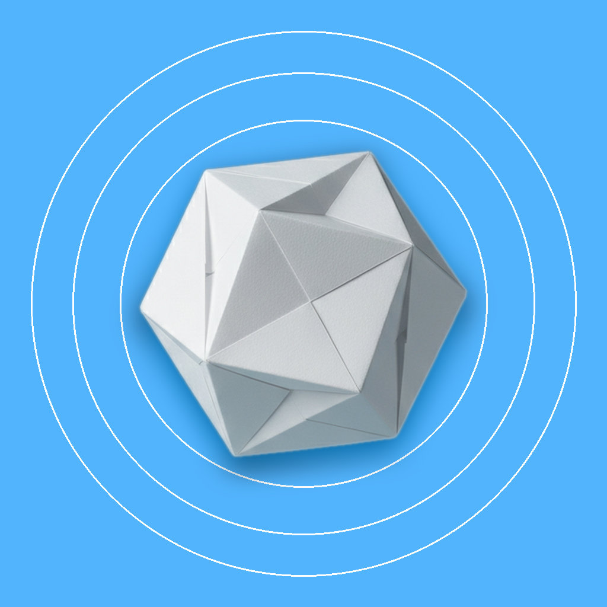
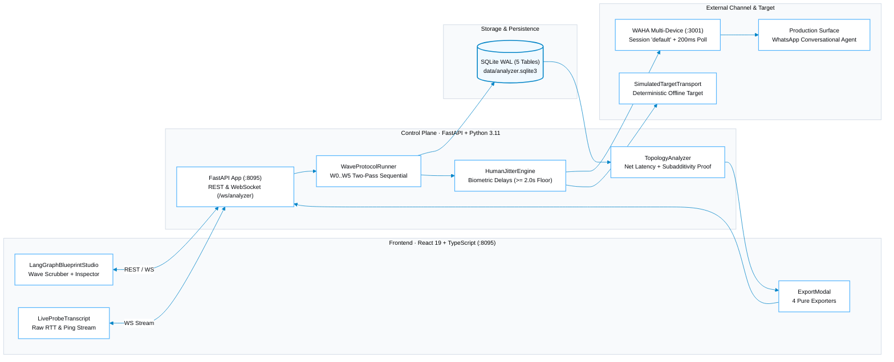

<p align="center">
  
</p>

<p align="center">
  <strong>Single-probe black-box conversational agent topology mapper (W0–W5) for WhatsApp &amp; LangGraph.</strong>
</p>

<p align="center">
  <a href="https://hsnlabs.ai/en/products/agent-analyzer/"></a>
  <a href="https://hsnlabs.ai"></a>
  <a href="LICENSE"></a>
  
  
  
</p>

---

##  Overview

**`agent-analyzer`** is a standalone surface reverse-engineering instrument maintained by [hsnlabs](https://hsnlabs.ai/en/products/agent-analyzer/) that reconstructs a target bot's hidden **`LangGraph StateGraph`** topology from black-box surface observations alone, using **1 WhatsApp probing session** (via a single WAHA Multi-Device container on `:3001` or the built-in deterministic simulator).

The system executes the **Two-Pass Sequential Replay Protocol** (`Pass 1 Discovery` &rarr; `/reset` Boundary &rarr; `Pass 2 Verification Replay`) across **6 progressive waves (`W0 -> W5`)**, advancing node confidence from hypothesis (`1/2`) to verified (`2/2`) across five architectural dimensions:

1. **Supervisor & Guardrail Boundaries (`W1`)** — Isolates static regex and keyword edge blocks ($L_{\text{net}} < 600\text{ms}$) from semantic router LLM redirects ($600\text{--}1800\text{ms}$).
2. **Read-Only Tool Nodes & Latency Fingerprints (`W2`)** — Maps catalog lookup, inventory, pricing, and scheduling tools using calibrated net latency ($L_{\text{net}} = \max(0, \text{RTT} - 2 \times \text{WS\_Ping})$).
3. **Confirmation-Gated Write Dry-Runs (`W3`)** — Discovers transactional order booking and refund nodes while detecting `interrupt_before` human-in-the-loop (HITL) gates without mutating external state.
4. **Subadditive Parallel Fan-Out (`W4`)** — Proves whether multi-intent turns execute via LangGraph `Send()` parallel fan-out or sequential routing using the subadditivity ratio ($\text{Ratio} = L_{A \wedge B} / (L_A + L_B) \le 0.72$).
5. **Memory Checkpointer Audit (`W5`)** — Injects canary tokens across conversational interrupts to audit thread memory retention and verify `SqliteSaver` / `PostgresSaver` state persistence.

---

##  Technical Architecture & Wave Protocol (`W0 -> W5`)

The control plane decouples internal SQLite WAL coordination from the external probing transport, eliminating multi-bot swarm complexity and guaranteeing strict anti-ban pacing floor ($\ge 2.0\text{s}$).



### The Six-Wave Probing Matrix (`W0 -> W5`)

| Wave | Stage Key | Probing Objective | Empirical Classification Rule | Inferred LangGraph Node |
| :--- | :--- | :--- | :--- | :--- |
| **`W0`** | `W0_BLACK_BOX` | Baseline ping & unprobed envelope | $\text{RTT} \approx 2 \times \text{WS\_Ping}$ | `__start__ -> unknown_blackbox_node -> __end__` |
| **`W1`** | `W1_SURFACE_GUARDRAILS` | Greeting, scope, & guardrail boundaries | $L_{\text{net}} < 600\text{ms}$ (Regex/Keyword) vs. $600\text{--}1800\text{ms}$ (Router) | `supervisor_router`, `response_synthesizer` |
| **`W2`** | `W2_READ_ONLY_TOOLS` | Inventory, pricing, catalog, and slots | $L_{\text{net}} \in [1800, 3200\text{ms}]$ across 2 passes | `Check_Inventory`, `Query_Pricing_Catalog`, `Check_Calendar_Slots` |
| **`W3`** | `W3_WRITE_DRY_RUN` | Mutating booking/refund action probes | Disclaimers present + `requires_confirmation = True` | `Create_Order_Booking`, `Execute_Refund_Reversal` (`interrupt_before`) |
| **`W4`** | `W4_PARALLEL_FANOUT` | Multi-intent compound probe $A \wedge B$ | $\text{Ratio} = L_{A \wedge B} / (L_A + L_B) \le 0.72$ (Subadditive) | Parallel branch (`parallel_quote_fanout`, `Send()`) |
| **`W5`** | `W5_MEMORY_CHECKPOINTER` | Topic interrupt, resume, & canary token | Canary recall $> 0.85$ across contextual pivot | `memory_checkpointer` (`SqliteSaver` / `PostgresSaver`) |

---

##  Blueprint Studio & Core Components

| Component | Implementation File | Verified Responsibility |
| :--- | :--- | :--- |
| **LangGraph Blueprint Studio** | [`LangGraphBlueprintStudio.tsx`](frontend/src/components/LangGraphBlueprintStudio.tsx) | Interactive visual canvas rendering the inferred `StateGraph` across waves `W0..W5`, with confidence badges (`1/2` vs `2/2`), node badges, and subadditive parallel cluster grouping. |
| **Live Probe Transcript** | [`LiveProbeTranscript.tsx`](frontend/src/components/LiveProbeTranscript.tsx) | Real-time WebSocket event terminal displaying raw turn pairs, outbound probes, inbound responses, `RTT`, `WS_Ping`, and calculated $L_{\text{net}}$. |
| **Node Telemetry Inspector** | [`NodeTelemetryInspector.tsx`](frontend/src/components/NodeTelemetryInspector.tsx) | Deep-dive telemetry drawer inspecting selected nodes: confidence score, net latency percentiles, model tier estimation (`Flash` vs `Pro`), and trigger transcript history. |
| **Wave Protocol Runner** | [`wave_runner.py`](agent_analyzer/runner/wave_runner.py) | Orchestrates the sequential execution of waves `W0` through `W5`, managing turn pacing, multi-pass replays, and context boundary resets (`/reset`). |
| **Topology Analyzer** | [`analyzer.py`](agent_analyzer/inspector/analyzer.py) | Mathematical engine performing latency net decomposition, subadditivity evaluation, confidence advancement, and state machine graph reconstruction. |
| **Biometric Jitter Engine** | [`jitter.py`](agent_analyzer/runner/jitter.py) | Anti-ban timing controller implementing log-normal reading delays, typing presence emulation, and a strict $\ge 2.0\text{s}$ turn interval floor. |
| **WAHA Single-Session Client** | [`whatsapp_client.py`](agent_analyzer/bridge/whatsapp_client.py) | Non-destructive connection reuse to WAHA `:3001` with `200ms` fast-polling window and deterministic `SimulatedTargetTransport` fallback. |
| **Deterministic Exporters** | [`exporters.py`](agent_analyzer/inspector/exporters.py) | Pure-function export suite compiling the inferred graph into 4 production formats in $< 15\text{ms}$. |

---

##  Verified SQLite Database Schema (`data/analyzer.sqlite3`)

All state is persisted in SQLite WAL mode ([`agent_analyzer/store/schema.sql`](agent_analyzer/store/schema.sql)) across **5 relational tables**:

| Table | Primary Key | Purpose & Verified Columns |
| :--- | :--- | :--- |
| `target_scans` | `scan_id` (UUID) | Root scan execution metadata: `target_name`, `transport_mode` (`LIVE_WHATSAPP` \| `SIMULATED`), `target_identifier`, `status` (`RUNNING`, `COMPLETED`, `FAILED`), `created_at`, `updated_at`. |
| `probe_turns` | `turn_id` (UUID) | Immutable turn telemetry: `scan_id`, `wave_index` (`0..5`), `pass_index` (`1..2`), `prompt_sent`, `response_received`, `raw_rtt_ms`, `waha_ping_ms`, `net_inference_ms`, `status`. |
| `topology_nodes` | `node_id` (TEXT) | Reconstructed graph nodes: `scan_id`, `node_key`, `node_type` (`ROUTER`, `TOOL`, `PARALLEL_BRANCH`, `CHECKPOINTER`, `SYNTHESIZER`), `confidence`, `avg_latency_ms`, `model_tier`. |
| `topology_edges` | `edge_id` (UUID) | Directed transitions: `scan_id`, `source_node`, `target_node`, `edge_type` (`CONDITIONAL`, `PARALLEL_SEND`, `DEFAULT`), `condition_label`, `sample_trigger`. |
| `analyzer_settings` | `key` (TEXT) | Runtime configuration: `waha_base_url`, `waha_session`, `min_turn_gap_s`, `pacing_mode`, `active_target`. |

---

##  REST & WebSocket API Reference (`agent_analyzer/server/app.py`)

| Method & Path | Response / Event Model | Description |
| :--- | :--- | :--- |
| `GET /api/health` | `dict` | Healthcheck returning server version and status (`{"status": "ok"}`). |
| `GET /api/scans` | `list[ScanSummary]` | Lists all active and historical target scans in SQLite. |
| `POST /api/scans` | `ScanRecord` | Initializes a new target scan in `SIMULATED` or `LIVE_WHATSAPP` mode. |
| `GET /api/scans/{scan_id}/topology` | `TopologyReport` | Returns the reconstructed topology (`nodes`, `edges`, `findings`, `wave_index`). |
| `POST /api/scans/{scan_id}/waves/{wave_index}` | `WaveExecutionResult` | Triggers sequential execution of a specific wave (`0..5`). |
| `GET /api/scans/{scan_id}/turns` | `list[ProbeTurnRecord]` | Fetches full chronological probe turn telemetry with net latency metrics. |
| `POST /api/scans/{scan_id}/export/{format}` | `FileResponse` / `ExportPayload` | Deterministically compiles and returns `langgraph_skeleton.py`, `topology.mmd`, `topology.json`, or `diagnostic_report.md`. |
| `GET /api/settings` / `POST /api/settings` | `AnalyzerSettingsPayload` | Reads or updates WAHA session connection parameters and jitter timing. |
| `WS /ws/analyzer` | `AnalyzerWsEvent` | Live WebSocket stream broadcasting `TURN_RECORDED`, `WAVE_ADVANCED`, and `NODE_DISCOVERED`. |

---

##  Deterministic Post-W5 Exporters (`exporters.py`)

Upon completing Wave 5, `agent-analyzer` deterministically compiles the verified SQLite graph topology into four standalone engineering artifacts:

1. **`langgraph_skeleton.py`** — Fully typed Python skeleton using `langgraph.graph.StateGraph` and `typing.TypedDict`, wiring conditional routers and parallel `Send()` branches.
2. **`topology.mmd`** — Clean Mermaid flowchart diagram with subgraphs and latency labels ready for technical documentation and pull requests.
3. **`topology.json`** — Strict schema JSON containing all node latencies, model tier estimates, edge conditions, and diagnostic findings.
4. **`diagnostic_report.md`** — Comprehensive forensic markdown dossier detailing P50/P95 latencies, potential bottlenecks, token drain vulnerabilities, and human handoff checks.

---

##  Quickstart & Verification

### 1. Install & Build

```bash
git clone https://github.com/hsnlabs-ai/agent-analyzer.git
cd agent-analyzer

# Setup Python backend environment
python3 -m venv .venv
source .venv/bin/activate
pip install -e ".[dev]"

# Build React 19 production bundle
npm --prefix frontend install
npm --prefix frontend run build
```

### 2. Launch the Blueprint Studio (`:8095`)

```bash
# Start FastAPI server on port 8095 (serves SPA on /)
agent-analyzer serve --port 8095
```

Open **[http://127.0.0.1:8095](http://127.0.0.1:8095)** in your browser. A pre-seeded deterministic scan (`default-simulated-scan`) is initialized out of the box, allowing you to run waves `W0..W5` and export artifacts immediately without external credentials.

### 3. Headless CLI Scan & Export

```bash
# Run headless 6-wave scan against simulated target
agent-analyzer scan \
  --mode SIMULATED \
  --target "simulated://retail-concierge-bot" \
  --output-dir ./exports
```

### 4. Optional: Live WhatsApp Probing via WAHA (`:3001`)

```bash
# Start local WAHA Multi-Device container
cp .env.example .env
docker compose -f docker-compose.waha.yml up -d
```

Open **[http://127.0.0.1:8095/settings](http://127.0.0.1:8095/settings)** to pair your single WhatsApp probing phone number via QR code and adjust anti-ban jitter settings (`min_turn_gap_s >= 2.0s`).

### 5. Automated Verification Suites

```bash
# Run backend pytest suite (store, waves, WAHA transport, exporters, REST/SPA)
pytest -v
```

---

##  Authors & License

Created by **[hsnlabs](https://hsnlabs.ai)**:
- **Hugo S. Nascimento** ([@hugosnascimento](https://github.com/hugosnascimento))
- **Ednaldo B. Souza Jr.** ([@ebsj](https://github.com/ebsj))

Official Product Documentation: **[https://hsnlabs.ai/en/products/agent-analyzer/](https://hsnlabs.ai/en/products/agent-analyzer/)**

Released under the [MIT License](LICENSE).
