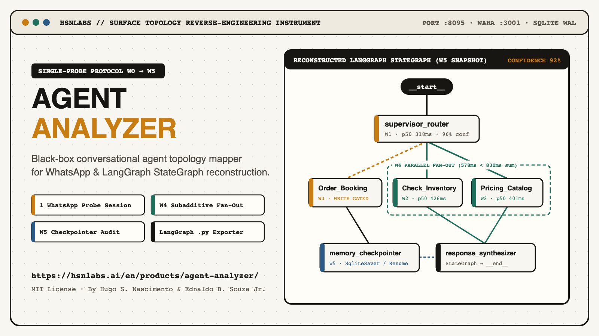
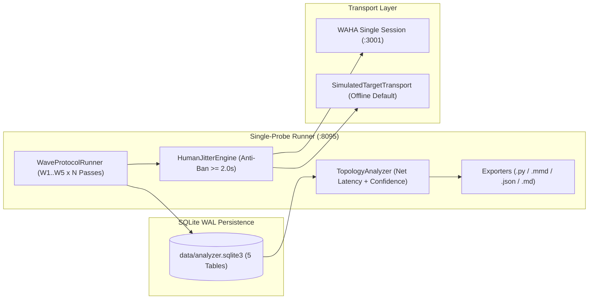

<p align="center">
  
</p>

<h1 align="center">agent-analyzer</h1>

<p align="center">
  <strong>Single-probe black-box conversational agent topology mapper (W0–W5) for WhatsApp &amp; LangGraph</strong><br/>
  Built by <a href="https://hsnlabs.ai">hsnlabs</a> · <a href="https://hsnlabs.ai/en/products/agent-analyzer/">Official Product Page</a>
</p>

<p align="center">
  <a href="https://hsnlabs.ai/en/products/agent-analyzer/"></a>
  <a href="https://github.com/hsnlabs-ai/agent-analyzer/blob/main/LICENSE"></a>
  
  
  
</p>

---

## Overview

**`agent-analyzer`** is a standalone surface reverse-engineering instrument for conversational AI agents. Using **1 WhatsApp probing session** (via a single WAHA Multi-Device container on `:3001` or the built-in deterministic target simulator), it executes a progressive **5-wave probing protocol (`W0 -> W5`)** to reconstruct a target bot's hidden **`LangGraph StateGraph`** topology from black-box surface observations alone:

- **Supervisor & Router Boundaries (`W1`)**: Identifies entry routing, scope boundaries, and safety/prompt-injection guardrails.
- **Read-Only Tool Nodes & Latency Fingerprints (`W2`)**: Separates fast cached lookups from external database/API tool calls using net latency (`raw_rtt_ms - waha_ping_ms`) and multi-pass agreement.
- **Confirmation-Gated Write Dry-Runs (`W3`)**: Maps transactional booking and refund tools without committing destructive state changes.
- **Subadditive Parallel Fan-Out Proof (`W4`)**: Proves whether multi-intent turns execute sequentially or in parallel (`T(A + B) < 0.78 * [T(A) + T(B)]`).
- **Memory Checkpointer & Thread Resume (`W5`)**: Infers `SqliteSaver` / `PostgresSaver` vs. ephemeral memory and extracts persisted `TypedDict` state keys across conversation interrupts.

---

## Architecture & Wave Protocol (`W0 -> W5`)



| Wave | Stage Label | Surface Probing Objective | Reconstructed Graph Elements |
| :--- | :--- | :--- | :--- |
| **`W0`** | `W0_BLACK_BOX` | Initial unprobed state | `__start__ -> unknown_blackbox_node -> __end__` |
| **`W1`** | `W1_SURFACE_GUARDRAILS` | Greeting, scope discovery, and guardrail boundary check | `supervisor_router`, `response_synthesizer` |
| **`W2`** | `W2_READ_ONLY_TOOLS` | Inventory, pricing, discount policy, and calendar probes | `Check_Inventory`, `Query_Pricing_Catalog`, `Verify_Discount_Policy`, `Check_Calendar_Slots` |
| **`W3`** | `W3_WRITE_DRY_RUN` | Non-committal dry-run probes for order booking and refund | `Create_Order_Booking`, `Execute_Refund_Reversal` (`requires_confirmation=True`) |
| **`W4`** | `W4_PARALLEL_FANOUT` | Compound multi-tool turn vs. sum of isolated tool latencies | Parallel execution group (`parallel_quote_fanout`) |
| **`W5`** | `W5_MEMORY_CHECKPOINTER` | Multi-turn context injection, topic interrupt, and resume | `memory_checkpointer` + persisted `TypedDict` state keys |

---

## Quickstart

### 1. Install Backend & Frontend

```bash
git clone https://github.com/hsnlabs-ai/agent-analyzer.git
cd agent-analyzer

python3 -m venv .venv
source .venv/bin/activate
pip install -e ".[dev]"

npm --prefix frontend install
npm --prefix frontend run build
```

### 2. Launch the Blueprint Studio (`:8095`)

```bash
agent-analyzer serve --port 8095
```

Open **[http://127.0.0.1:8095](http://127.0.0.1:8095)** in your browser. Out of the box, `agent-analyzer` seeds a ready-to-run deterministic target (`default-simulated-scan`) so you can step through waves `W0 -> W5`, scrub historical wave snapshots, and export artifacts immediately without configuring external credentials.

### 3. Headless CLI Scan & Artifact Export

```bash
agent-analyzer scan \
  --mode SIMULATED \
  --target "simulated://retail-concierge-bot" \
  --output-dir ./exports
```

This runs waves `W1..W5` and writes all 4 deliverables to `./exports/`:
1. `langgraph_skeleton.py` — Valid, runnable Python `LangGraph StateGraph` code with `TypedDict` state and conditional/parallel routing.
2. `topology.mmd` — Mermaid `flowchart TD` diagram with `W4` parallel fan-out subgraph and latency annotations.
3. `topology.json` — Complete JSON bundle (`TopologyReport`, `DiagnosticFinding[]`, and `ProbeTurnRecord[]`).
4. `diagnostic_report.md` — Executive latency, bottleneck, token-drain, and security audit report.

### 4. Optional: Live WhatsApp Probing via WAHA (`:3001`)

To probe a live external WhatsApp agent using a single WhatsApp Multi-Device session:

```bash
cp .env.example .env
docker compose -f docker-compose.waha.yml up -d
```

Then open **[http://127.0.0.1:8095/settings](http://127.0.0.1:8095/settings)** to pair your probing phone number via QR code and configure anti-ban human jitter pacing (`min_turn_gap_s >= 2.0s`).

---

## Verification & Testing

```bash
pytest -v
```

---

## Authors & License

Created by **[hsnlabs](https://hsnlabs.ai)**:
- **Hugo S. Nascimento** ([@hugosnascimento](https://github.com/hugosnascimento))
- **Ednaldo B. Souza Jr.** ([@ebsj](https://github.com/ebsj))

Product documentation: **[https://hsnlabs.ai/en/products/agent-analyzer/](https://hsnlabs.ai/en/products/agent-analyzer/)**

Released under the [MIT License](LICENSE).
