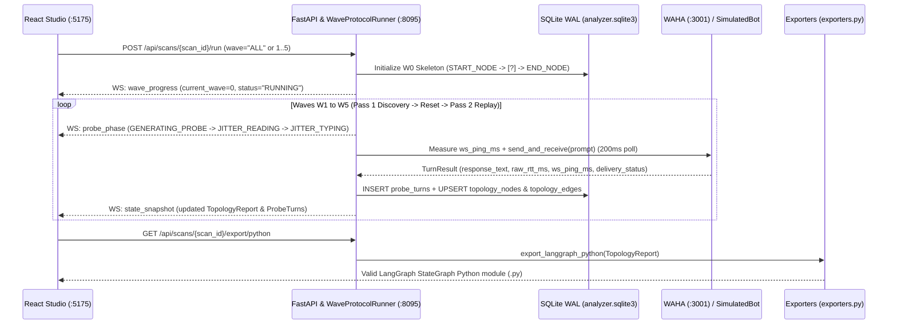

# Agent Analyzer: Standalone Single-Probe Black-Box Topology Mapper

*   **Author:** Hugo S. Nascimento (`@hugosnascimento`) & Ednaldo B. Souza Jr. (`@ebsj`) — hsnlabs
*   **Status:** Draft
*   **Date:** 2026-11-01

--------------------------------------------------------------------------------

## Overview

**Agent Analyzer** (`hsnlabs-ai/agent-analyzer`, `https://hsnlabs.ai/en/products/agent-analyzer/`) is a standalone open-source application extracted from `agents-swarm` into `/Users/hugosoares/GitHub/agent-analyzer`. It maps the internal execution topology, routing rules, model tiers, sampling temperatures, parallel execution branches, and conversation memory persistence of WhatsApp agents from the outside in using a single sequential probing bot (`N = 1`).

Whereas `agents-swarm` is built around a multi-agent colony with a Queen homeostasis controller, an Incubator SIM/SMS credential vault, a 72-hour peer-to-peer warmup schedule, and pixel-art bee meadows, **Agent Analyzer** removes all swarm and warmup machinery. It focuses exclusively on black-box conversational reverse engineering for two audiences:

1.  **Agent Builders, Product Managers, and Agencies:** Operators who connect a WhatsApp session via QR code (or launch a zero-config local simulation), enter a target bot phone number, watch the 6-wave state graph (`W0` to `W5`) construct itself alongside the live chat transcript, and read a diagnostic report showing where the target bot blocks users, stalls on tool calls, or consumes unnecessary token budget.
2.  **Agent Developers (`LangGraph`, `CrewAI`, `n8n`, `Typebot`, `Dify`):** Engineers who profile a staging or production WhatsApp bot to measure net inference latency (`L_net`), token throughput (`tokens/s`), sampling temperature divergence (`T_hat`), parallel fan-out efficiency (`L_AB` vs. `L_A + L_B`), and checkpointer state retention (`thread_id`), then export the discovered topology as an executable Python `LangGraph StateGraph` skeleton, a `Mermaid` diagram, a `Topology JSON` bundle, or a `Markdown` diagnostic report.

In addition to the backend engine and React studio workspace, this project encompasses creating the standalone repository at `/Users/hugosoares/GitHub/agent-analyzer`, generating official brand assets (`assets/logo-square.png`, `assets/banner.png`, `assets/social-preview-1280x640.png`), configuring product links for `https://hsnlabs.ai/en/products/agent-analyzer/`, and publishing `hsnlabs-ai/agent-analyzer` on GitHub under the MIT license.

## The Problem

Extracting the topology mapper from `/Users/hugosoares/GitHub/agents-swarm` into a standalone single-probe product requires solving six technical problems identified in the reference codebase:

1.  **Split-Brain Topology State Machine and Wave Sequence Mismatch:**
    In `agents-swarm`, topology reconstruction is divided across three disconnected code paths:
    *   `InspectorService.reconstruct_state_machine()` (`agents_swarm/inspector/analyzer.py`) clusters `TurnRecord` rows into `GardenNode` and `GardenEdge` objects.
    *   `InspectorService.infer_langgraph_topology()` ignores that reconstructed graph and returns a hardcoded 9-node static fixture keyed only by `turn_count` (`0..5`).
    *   `buildLocalLangGraphReport()` (`frontend/src/components/GardenLangGraphBlueprint.tsx`) duplicates that 500-line fixture inside the React client and cycles `W0 -> W5 -> W0` on a `3200ms` `window.setInterval` timer without querying the backend API.
    Furthermore, the legacy wave ordering in `agents-swarm` does not match `agent-analyzer`'s 6-wave single-probe protocol (`W0` skeleton -> `W1` static guardrails `<600ms` -> `W2` conditional `OR` routers `600-1800ms` -> `W3` temperature `T_hat` and model tier `Flash`/`Pro` -> `W4` parallel `AND` subadditive latency proof `L_AB ~= max(L_A, L_B)` -> `W5` stateful checkpointer verification).
2.  **Single-Probe (`N = 1`) Thread State Contamination vs. Multi-Scout Consensus:**
    In `agents-swarm`, node verification (`PAIRED_VERIFIED`) and sampling temperature estimation (`estimate_temperature_from_samples()`) require two separate WhatsApp phone numbers (`Scout-001` Pioneer and `Scout-002` Verifier) probing the target on independent WhatsApp threads (`{phone}@c.us`), enforcing `len(distinct_scouts) >= 2`. In a single-probe architecture (`N = 1`), sending a second identical prompt in `W3` or testing an alternate `OR` branch from the same WhatsApp number reaches the target bot on a dirty conversation thread, and the `len(distinct_scouts) >= 2` rule permanently blocks `2/2` verification.
3.  **WAHA `1.2s` Polling Quantization, Silent Simulation Fallback, and `26s` Timeout Pollution:**
    In `agents_swarm/bridge/whatsapp_client.py` (`HybridHiveTransport.send_and_receive`):
    *   The reply loop sleeps for `1.2s` before its first poll and hardcodes `ws_ping_ms = 75`, creating a floor of `raw_rtt_ms >= 1200ms` (`net_inference_ms >= 1125ms`). This quantization prevents detecting `<600ms` static guardrails (`W1`) or measuring subadditive parallel latencies (`W4`) on live WhatsApp targets.
    *   When `transport_mode == "LIVE_WHATSAPP"` and WAHA is offline or unpaired, `send_and_receive` silently switches to `SimulatedGardenTransport`, returning synthetic retail responses without alerting the operator.
    *   When a live target does not reply within `26s`, `send_and_receive` returns `status_code = 200`, `raw_rtt_ms = 26000`, and a synthetic `[WAHA DELIVERED TO ...]` message, which `InspectorService` clusters as a `CORE_LLM_RAG` node.
4.  **SQLite Foreign-Key Breakage, Swarm Coupling, and Lossy Node Persistence:**
    In `agents_swarm/honeycomb/schema.sql`, `turns.scout_id` and `turns.mission_id` enforce foreign keys against `scouts` and `missions`, while `garden_nodes` and `garden_edges` persist only 6 and 5 columns respectively (losing `inferred_temperature`, `temperature_band`, `lexical_divergence`, `inferred_model_tier`, `inferred_router_type`, `super_step_group`, `langgraph_primitive`, and `edge_kind` across restarts). In addition, `ScoutAgentRuntime` and `whatsapp_client.py` invoke `IncubatorService`, `ledger.update_scout_heat`, and an out-of-state `_PendingTurnData` dictionary, and restrict live dialing to a single global `.env` phone number (`resolve_safe_target_number`).
5.  **Port Collisions, Shared WAHA Session Safety, and Single-Number Rate Pacing:**
    `agents-swarm` occupies ports `:8090` (FastAPI), `:5173` (Vite), and `:3001` (WAHA `default` session). Running `agent-analyzer` on the same machine requires dedicated ports (`:8095` for FastAPI, `:5175` for Vite), non-destructive attachment to WAHA `:3001` when `default` is already `WORKING`, and a pacing floor (`min_turn_gap_s >= 2.0s`, `live_jitter_sleep_scale >= 0.35`) in `LIVE_WHATSAPP` mode so the single WhatsApp session is not rate-limited by Meta.
6.  **Missing Post-`W5` Export Generators:**
    `agents-swarm` has no export serializers for Python `LangGraph StateGraph` code, `Mermaid` diagrams, standalone `Topology JSON`, or `Markdown` diagnostic reports.

**The Proposed Solution:** Build `agent-analyzer` in `/Users/hugosoares/GitHub/agent-analyzer` with:
*   A unified backend topology engine (`agent_analyzer/inspector/analyzer.py`) backed by a 5-table SQLite WAL database (`data/analyzer.sqlite3`) that persists all `W0..W5` node and edge telemetry and eliminates all client-side static graph fixtures.
*   A **Two-Pass Sequential Replay Protocol** (`WaveProtocolRunner`) for `N = 1` probing that executes `Pass 1 (Initial Discovery)` followed by an explicit session reset / context boundary turn and `Pass 2 (Verification Replay)`, advancing nodes from `SINGLE_PASS_HYPOTHESIS (1/2)` to `REPLAY_VERIFIED (2/2)`.
*   A single-session WAHA transport (`agent_analyzer/bridge/whatsapp_client.py`) that reuses a persistent `httpx.AsyncClient`, measures live `ws_ping_ms`, polls at `200ms` intervals during active turn waits, fails explicitly when WAHA is offline or unpaired in `LIVE_WHATSAPP` mode, and tags `26s` timeouts with `delivery_status = "TIMEOUT"`.
*   Four deterministic pure-function exporters (`agent_analyzer/inspector/exporters.py`) exposed at `GET /api/scans/{scan_id}/export/{format}` (`python`, `mermaid`, `json`, `markdown`).
*   A dedicated React 19 Studio UI (`frontend/`) on `:5175` proxying to FastAPI on `:8095`, plus official visual assets and GitHub repository publication at `hsnlabs-ai/agent-analyzer`.

## Goals

*   **Standalone Repository and Runtime Isolation:** Create `/Users/hugosoares/GitHub/agent-analyzer` with Python package `agent_analyzer` (`:8095`), React 19 + TypeScript frontend (`:5175`), and SQLite WAL database (`data/analyzer.sqlite3`) with zero imports from `agents_swarm` and zero swarm/incubator dependencies.
*   **6-Wave Single-Probe (`N = 1`) Discovery Engine (`W0..W5`):** Implement `WaveProtocolRunner` and `HumanJitterEngine` to execute:
    *   `W0`: Empty `[ ? ]` architectural skeleton initialization (`START_NODE -> [?] -> END_NODE`).
    *   `W1`: Static edge guardrail discovery (`L_net < 600ms`, regex/keyword filter classification).
    *   `W2`: Conditional `OR` semantic router and human-in-the-loop `interrupt()` gate discovery (`600ms <= L_net < 1800ms`).
    *   `W3`: Sampling temperature (`T_hat`) and model tier (`Flash` vs. `Pro` token throughput) estimation via Two-Pass Sequential Replay.
    *   `W4`: Parallel `AND` super-step (`Send()` fan-out + barrier join) verification via subadditive latency proof (`L_AB ~= max(L_A, L_B)` with `subadditivity_ratio = L_AB / (L_A + L_B) <= 0.72`).
    *   `W5`: Stateful `checkpointer` (`thread_id`) memory persistence verification across turns and pass resets.
*   **Dual-Mode WhatsApp Transport (`LIVE_WHATSAPP` + `SIMULATED`):** Support live WhatsApp probing through 1 WAHA Multi-Device QR session (`session="default"` on `:3001`, `200ms` initial reply polling, measured `ws_ping_ms`, explicit `WAHA_OFFLINE` / `WAHA_QR_REQUIRED` error reporting, `TIMEOUT` turn isolation, and `min_turn_gap_s >= 2.0s` pacing floor) alongside a deterministic offline `SIMULATED` transport that exercises all `W0..W5` waves without external credentials.
*   **Full-Screen Blueprint Studio UI:** Build a React 19 interface with a Left Sidebar (`Target Scans` list, `+ New Scan`, and bottom `Settings` button) and a main workspace containing the **LangGraph Blueprint Studio (`W0..W5`)**, **Wave Time-Travel Scrubber**, **Live Probe Chat Transcript** (with phase badges: `GENERATING_PROBE`, `JITTER_READING`, `JITTER_THINKING`, `JITTER_TYPING`, `WAITING_TARGET_REPLY`), **Node Telemetry Inspector**, and **Export Action Bar**.
*   **Four Deterministic Post-`W5` Export Deliverables:** Expose `GET /api/scans/{scan_id}/export/{format}` and UI Copy/Download actions for:
    1.  `python`: Executable `LangGraph StateGraph` Python skeleton (`langgraph_skeleton.py`).
    2.  `mermaid`: State and routing diagram (`topology.mmd`).
    3.  `json`: Complete `TopologyReport` and `DiagnosticReport` JSON bundle (`topology.json`).
    4.  `markdown`: Diagnostic, latency breakdown, and token-drain cost report (`diagnostic_report.md`).
*   **Brand Identity Assets, Website Metadata, and GitHub Publication:** Generate `assets/logo-square.png`, `assets/banner.png`, and `assets/social-preview-1280x640.png`; configure `README.md`, `frontend/index.html` Open Graph tags, and institutional footer links for `https://hsnlabs.ai/en/products/agent-analyzer/` and `https://hsnlabs.ai`; and create and push the public GitHub repository `hsnlabs-ai/agent-analyzer`.

## Non-Goals

*   **Multi-Agent Swarm Orchestration:** No `QueenController` homeostasis loop, multi-scout scheduling, or `Swarm` Kanban board.
*   **SIM/SMS Provisioning, Credential Vaults, or Warmup Meadows:** No `IncubatorService`, `IdentityVault` Fernet key rotation, sticky residential proxy ASN validation, or 72-hour P2P warmup traffic (`SandboxGardenScheduler`).
*   **Pixel-Art Bee Meadows and Sprite Components:** No `PixelHiveCanvas.tsx`, `ScoutBeeGlyph`, `QueenBeeGlyph`, or `ScoutProfileModal.tsx`.
*   **Generic HTTP Webhook or Webchat Connectors in MVP:** Target channel support in this release is strictly WhatsApp (via WAHA) plus the built-in local simulation target (`SIMULATED` mode).
*   **Volumetric Load or Stress Testing:** `agent-analyzer` is a structural and latency profiler using a single sequential probe (`N = 1`), not a concurrency load generator.

## Open Questions

*   None. Target channels (WhatsApp via WAHA + Local Simulation), export formats (all 4 formats), UI studio layout, standalone repository location (`/Users/hugosoares/GitHub/agent-analyzer`), and GitHub publication target (`hsnlabs-ai/agent-analyzer` linked to `https://hsnlabs.ai/en/products/agent-analyzer/`) were resolved with the user prior to drafting.

## Critical User Journeys (CUJs)

### CUJ 1: Zero-Config Simulated 6-Wave Scan (`W0..W5`) and Time-Travel Wave Scrubbing

*   **Given**: The operator starts `agent-analyzer` locally (`:8095` backend, `:5175` frontend) with no external LLM API keys or WhatsApp session configured.
*   **When**: The operator clicks `+ New Scan` in the Left Sidebar, selects `SIMULATED` mode (Target: `Simulated E-Commerce & Pix Support Bot`), and clicks `Run 6-Wave Scan (W0..W5)`.
*   **Then**:
    *   `WaveProtocolRunner` executes waves `W1` through `W5` sequentially across two passes (`Pass 1: Initial Discovery` and `Pass 2: Verification Replay`), streaming real-time WebSocket updates (`/ws/analyzer`) for each probe phase (`GENERATING_PROBE -> JITTER_READING -> JITTER_THINKING -> JITTER_TYPING -> WAITING_TARGET_REPLY`).
    *   The Blueprint Studio canvas advances through `W0 -> W1 -> W2 -> W3 -> W4 -> W5` driven strictly by the backend SQLite state (`data/analyzer.sqlite3`).
    *   Clicking any wave pill (`W0` through `W5`) in the Wave Time-Travel Scrubber filters the rendered graph and telemetry counters to the historical snapshot discovered up to that wave without resetting or re-running the scan.

### CUJ 2: Live WhatsApp QR Pairing and Two-Pass Sequential Probing (`N = 1`)

*   **Given**: The operator opens `Settings -> WhatsApp (WAHA)` in the Left Sidebar while WAHA is running on `http://localhost:3001`.
*   **When**: The operator pairs their WhatsApp account via the in-app QR modal (or attaches non-destructively to an already `WORKING` `default` session), creates a new scan in `LIVE_WHATSAPP` mode with target E.164 number `+5511999999999`, and triggers a scan.
*   **Then**:
    *   `WAHAWhatsAppClient` measures live `ws_ping_ms` before each wave, enforces a minimum turn gap of `>= 2.0s` plus biomimetic reading/typing jitter (`live_jitter_sleep_scale >= 0.35`), and polls for incoming target replies at `200ms` intervals.
    *   In `Pass 1`, discovered nodes enter `SINGLE_PASS_HYPOTHESIS (1/2)`. Between `Pass 1` and `Pass 2`, the probe sends an explicit session-reset / context-boundary turn (`#reset` / fresh topic frame) before replaying the wave prompts, promoting verified nodes to `REPLAY_VERIFIED (2/2)`.
    *   If WAHA disconnects mid-scan, the scan transitions to `ERROR` (`WAHA_OFFLINE` or `WAHA_QR_REQUIRED`) and halts rather than silently substituting simulated responses.

### CUJ 3: Node Telemetry Inspection, Subadditive Parallel Proof (`W4`), and Live Probe Chat Synchronization

*   **Given**: A scan has completed `W4` and `W5`.
*   **When**: The operator clicks a discovered `PARALLEL_TOOL_NODE` or `CORE_LLM_RAG` node on the Blueprint Studio SVG canvas.
*   **Then**:
    *   The **Node Telemetry Inspector** displays the node's net inference latency (`L_net = raw_rtt_ms - ws_ping_ms`), estimated token throughput (`tokens/s`), inferred model tier (`Flash / Mini` vs. `Pro / Sonnet`), sampling temperature (`T_hat` and lexical divergence `D_lex` across Pass 1 and Pass 2), verification badge (`1/2` or `2/2`), and—for `W4` parallel `Send()` nodes—the subadditive timing proof (`L_A`, `L_B`, `L_AB`, and `subadditivity_ratio = L_AB / (L_A + L_B)`).
    *   The **Live Probe Chat Transcript** highlights the exact probe turns (`turn_id`, Pass 1 and Pass 2 prompts/responses, and `L_net` badges) that traversed the selected node.

### CUJ 4: Post-`W5` Multi-Format Export (`Python StateGraph`, `Mermaid`, `Topology JSON`, `Markdown Diagnostic Report`)

*   **Given**: A target scan has reached `W3` or `W5` with reconstructed `topology_nodes` and `topology_edges` in `data/analyzer.sqlite3`.
*   **When**: The operator clicks `Export LangGraph (.py)`, `Export Mermaid (.mmd)`, `Export JSON (.json)`, or `Export Diagnostic Report (.md)` in the Export Action Bar.
*   **Then**:
    *   The frontend fetches `GET /api/scans/{scan_id}/export/{format}` (`python | mermaid | json | markdown`) from `exporters.py`.
    *   The `python` export returns a syntactically valid Python module (`compile(code, "langgraph_skeleton.py", "exec")` succeeds) defining a `TypedDict` state, node functions annotated with measured `L_net` and `T_hat`, conditional `OR` routing edges, parallel `Send()` fan-out edges, and `MemorySaver` checkpointer compilation.
    *   The `mermaid`, `json`, and `markdown` exports return deterministic representations of the persisted SQLite topology and diagnostic bottleneck analysis, with one-click Copy to Clipboard and file download.

### CUJ 5: Standalone Repository Creation, Brand Assets Generation, and GitHub Publication

*   **Given**: All backend, frontend, exporter, and automated test suites pass inside `/Users/hugosoares/GitHub/agent-analyzer`.
*   **When**: The final publication phase executes.
*   **Then**:
    *   Official visual assets (`assets/logo-square.png`, `assets/banner.png`, `assets/social-preview-1280x640.png`) exist in `/Users/hugosoares/GitHub/agent-analyzer/assets/` and are linked in `README.md` and `frontend/index.html`.
    *   `README.md`, `LICENSE` (MIT), and the UI institutional footer link to `https://hsnlabs.ai/en/products/agent-analyzer/` and `https://hsnlabs.ai`.
    *   The standalone git repository is initialized, committed, and published to `https://github.com/hsnlabs-ai/agent-analyzer`.

## Technical Plan (Architecture)

### 1. System Architecture & End-to-End Data Flow

`agent-analyzer` runs as a two-tier local application with a FastAPI + SQLite WAL backend on port `:8095` and a React 19 + TypeScript Studio frontend on port `:5175` (which also compiles into `frontend/dist` for single-port Model A serving from `:8095`). Live WhatsApp scans connect to a single WAHA container on port `:3001` (`session="default"`).

```text
+===================================================================================================+
|                        REACT 19 STUDIO FRONTEND (:5175 dev / :8095 prod)                          |
|                                                                                                   |
|  +-----------------------+  +------------------------------------------------------------------+  |
|  | Left Sidebar          |  | Main Blueprint Studio Workspace                                  |  |
|  | - Target Scans List   |  |  +------------------------------------------------------------+  |  |
|  | - + New Scan Modal    |  |  | Top Control & Wave Time-Travel Scrubber (W0..W5 | All)     |  |  |
|  | - WAHA Status Pill    |  |  +------------------------------------------------------------+  |  |
|  | - Bottom Settings Btn |  |  | LangGraph Blueprint SVG Canvas | Live Probe Chat &         |  |  |
|  |   (/settings/:tab)    |  |  | (Nodes, OR/AND Edges,          | Node Telemetry Inspector  |  |  |
|  |                       |  |  |  Super-Step Hulls, Badges)     | + Export Action Bar       |  |  |
|  +-----------------------+  +------------------------------------------------------------------+  |
+================================================|==================================================+
                                                 | REST (/api/*) + WebSocket (/ws/analyzer)
                                                 v
+===================================================================================================+
|                          FASTAPI BACKEND (agent_analyzer/server/app.py :8095)                     |
|                                                                                                   |
|  +---------------------------------------------+  +--------------------------------------------+  |
|  | AnalyzerRuntimeManager (runtime.py)         |  | TopologyAnalyzer & Exporters (inspector/)  |  |
|  | - WaveProtocolRunner (W0 -> W5, 2 Passes)   |  | - reconstruct_and_persist_topology()       |  |
|  | - HumanJitterEngine (Reading/Thinking/      |  | - build_topology_report() (W0..W5 filter)  |  |
|  |   Typing + >=2.0s Live Pacing Floor)        |  | - export_langgraph_python() (.py)          |  |
|  | - Live Probe Phase Broadcaster (/ws)        |  | - export_mermaid() (.mmd)                  |  |
|  +----------------------+----------------------+  | - export_topology_json() (.json)           |  |
|                         |                         | - export_markdown_report() (.md)           |  |
|                         v                         +---------------------+----------------------+  |
|  +---------------------------------------------+                        |                         |
|  | Dual-Mode Transport (bridge/whatsapp_client)|                        v                         |
|  | - WAHAWhatsAppClient (:3001, 200ms poll,    |  +--------------------------------------------+  |
|  |   measured ws_ping_ms, strict live errors)  |  | SQLite WAL Store (data/analyzer.sqlite3)   |  |
|  | - SimulatedTargetTransport (deterministic   |  | - target_scans     - topology_nodes        |  |
|  |   offline W0..W5 retail/Pix bot)            |  | - probe_turns      - topology_edges        |  |
|  +---------------------------------------------+  | - analyzer_settings                        |  |
|                                                   +--------------------------------------------+  |
+===================================================================================================+
```



---

### 2. Six-Wave Single-Probe (`N = 1`) Discovery & Two-Pass Sequential Replay Protocol

Because `agent-analyzer` operates with a single probing identity (`N = 1`) rather than a multi-number scout swarm, `WaveProtocolRunner` (`agent_analyzer/runner/wave_runner.py`) replaces multi-scout consensus (`len(distinct_scouts) >= 2`) with a **Two-Pass Sequential Replay Protocol**:

1.  **Pass 1 (`pass_index = 1`, Initial Discovery):** Executes the wave's probe prompts sequentially. Newly discovered nodes and edges are persisted with `verification_status = "SINGLE_PASS_HYPOTHESIS"` (`1/2`) and `confidence = 0.65`.
2.  **Inter-Pass Context Boundary Reset (`probe_category = "SESSION_RESET"`):** Before starting Pass 2 on stateful waves (`W1..W4`), `WaveProtocolRunner` sends an explicit session-boundary reset turn (`"/reset\nEncerrar atendimento anterior. Iniciar nova conversa independente."`) so target agents with conversation memory reset or segment their context window.
3.  **Pass 2 (`pass_index = 2`, Verification Replay):** Re-sends the wave's probe prompts (or paired counterfactual variations) after the session reset. When a node's latency band and routing branch match Pass 1, `TopologyAnalyzer` upgrades `verification_status` to `"REPLAY_VERIFIED"` (`2/2`), increments `pass_count` to `2`, and updates `confidence` to `>= 0.92`. If Pass 2 routes to a contradictory node type, `verification_status` is marked `"DIVERGENT_BEHAVIOR"`.

#### Wave-by-Wave Execution Specification (`W0` to `W5`)

| Wave | Name & Target Primitive | Probe Strategy (`Pass 1` + `Pass 2`) | Quantitative Classification Rule |
| :--- | :--- | :--- | :--- |
| **`W0`** | **Architectural Skeleton (`START -> [?] -> END`)** | Zero network turns. Initializes the baseline unverified graph in SQLite when a scan is created or reset. | Inserts `START_NODE`, `UNKNOWN_BLACKBOX_NODE` (`[ ? ]`), and `END_NODE` with `discovered_in_wave = 0`. |
| **`W1`** | **Static Edge Guardrails (`STATIC_GUARDRAIL`)** | Sends prompt-injection / policy-refusal / malformed-input probes (`probe_category = "W1_GUARDRAIL"`). | `L_net = max(1, raw_rtt_ms - ws_ping_ms) < 600ms` and `D_lex < 0.05` across Pass 1 & Pass 2 -> classifies node as `STATIC_GUARDRAIL` (`inferred_model_tier = "STATIC_ZERO_LLM"`, `inferred_router_type = "REGEX_KEYWORD_GATE"`, `langgraph_primitive = "add_conditional_edges"`). |
| **`W2`** | **Conditional `OR` Semantic Routers & `interrupt()` Gates** | Sends mutually exclusive domain intents (`probe_category = "W2_ROUTER_BRANCH_A"`, `"W2_ROUTER_BRANCH_B"`, and `"W2_HITL_INTERRUPT"`). | `600ms <= L_net < 1800ms` -> classifies routing dispatcher as `SEMANTIC_ROUTER` with outgoing `CONDITIONAL_OR` edges to distinct downstream tool/RAG nodes. Refusal/escalation prompts requiring supervisor approval are classified as `HUMAN_HANDOFF_INTERRUPT` (`langgraph_primitive = "interrupt()"`). |
| **`W3`** | **Temperature (`T_hat`) & Model Tier Fingerprinting** | Sends open-ended synthesis prompts identically in Pass 1 and Pass 2 (`probe_category = "W3_TEMP_PROBE"`). | Computes token-level lexical divergence $D_{\text{lex}} = 1 - \frac{|T_1 \cap T_2|}{|T_1 \cup T_2|} \in [0, 1]$ between Pass 1 and Pass 2 responses. Estimates $\hat{T} = \text{round}(\min(1.0, 1.15 \cdot D_{\text{lex}}), 2)$ (`DETERMINISTIC_0_0` if $\hat{T} < 0.15$; `LOW_TEMP_0_2_0_4` if $0.15 \le \hat{T} < 0.45$; `CREATIVE_0_7_PLUS` if $\hat{T} \ge 0.45$). Computes token velocity $v_{\text{tok}} = \frac{\text{tokens}_{\text{out}}}{\max(L_{\text{net}} - 350, 100) / 1000}$: classifies `FLASH_MINI_TIER` when $v_{\text{tok}} \ge 55\text{ tok/s}$ or $L_{\text{net}} < 1600\text{ms}$, and `PRO_SONNET_TIER` when $v_{\text{tok}} < 55\text{ tok/s}$ and $L_{\text{net}} \ge 1600\text{ms}$. |
| **`W4`** | **Parallel `AND` Super-Step (`Send()` Fan-Out Proof)** | Executes 3-step subadditive timing triad (`probe_category = "W4_ISOLATED_A"`, `"W4_ISOLATED_B"`, `"W4_COMPOUND_AB"`): (1) Tool A alone ($L_A$), (2) Tool B alone ($L_B$), (3) Compound prompt invoking both Tool A and Tool B ($L_{AB}$). | Computes `subadditivity_ratio = L_AB / (L_A + L_B)`. If `subadditivity_ratio <= 0.72` and `L_AB <= 1.35 * max(L_A, L_B)`, classifies Tool A and Tool B as `PARALLEL_TOOL_NODE` sharing `super_step_group = "parallel_fanout_w4"`, linked via `PARALLEL_AND` (`Send()`) edges into a downstream `JOIN_BARRIER` reducer node. Otherwise classifies them as sequential `SEQUENTIAL` edges. |
| **`W5`** | **Stateful Checkpointer (`thread_id`) Verification** | Executes 3-turn memory persistence test (`probe_category = "W5_PLANT_CANARY"`, `"W5_DISTRACTOR"`, `"W5_RECALL_CANARY"`): plants a unique canary token (e.g., `protocolo #AZ-7741`), sends a distractor question, then asks the bot to repeat the protocol code without restating it. | If the canary token appears in the `W5_RECALL_CANARY` response, upgrades the `STATEFUL_CHECKPOINTER` node to `REPLAY_VERIFIED (2/2)` (`langgraph_primitive = "MemorySaver(thread_id)"`). If absent, records `STATELESS_NO_MEMORY` and emits a `STATELESS_CONTEXT_LOSS` diagnostic bottleneck. |

---

### 3. High-Resolution Single-Session WAHA Transport & Pacing Safeguards

`agent_analyzer/bridge/whatsapp_client.py` replaces `HybridHiveTransport` with two explicit, non-overlapping classes: `WAHAWhatsAppClient` (for `LIVE_WHATSAPP` scans) and `SimulatedTargetTransport` (for `SIMULATED` scans).

1.  **Persistent HTTP Client & Non-Destructive Session Attachment:**
    *   `WAHAWhatsAppClient` holds a single persistent `httpx.AsyncClient(timeout=15.0)` for its lifecycle, closed during FastAPI shutdown.
    *   When checking or starting a session on `http://localhost:3001` (`session="default"`), `get_session_status()` queries `GET /api/sessions/default`. If `status == "WORKING"`, it attaches directly without calling `POST /api/sessions/default/restart` or `POST /api/sessions/stop`, ensuring an active WhatsApp pairing shared with `agents-swarm` is never disrupted.
2.  **Pre-Wave `ws_ping_ms` Calibration & `200ms` Reply Polling:**
    *   Before each wave in `LIVE_WHATSAPP` mode, `measure_waha_ping_ms()` performs 3 lightweight requests to `GET /api/sessions/default` and records the median round-trip time as `ws_ping_ms` (bounded to `[5, 500] ms`).
    *   After `POST /api/sendText` succeeds at $t_0$, `send_and_receive()` polls `GET /api/{session}/chats/{chatId}/messages?limit=10&downloadMedia=false` using a two-tier schedule:
        *   **Fast Window (`0.0s .. 3.0s`):** Polls every `200ms` (`0.2s`), providing the time resolution required to detect `< 600ms` `W1` static guardrails and `W4` parallel fan-out timing.
        *   **Standard Window (`3.0s .. 26.0s`):** Polls every `400ms` (`0.4s`) up to the `26.0s` deadline.
3.  **Strict Live Error Isolation (Zero Silent Fallback) & Timeout Tagging:**
    *   If `scan.transport_mode == "LIVE_WHATSAPP"` and WAHA is unreachable or its session state is `SCAN_QR_CODE` / `STOPPED` / `FAILED`, `WAHAWhatsAppClient` raises `WAHATransportError(error_code="WAHA_OFFLINE" | "WAHA_QR_REQUIRED", message=...)`. The runner catches this, updates `target_scans.status = "ERROR"`, and broadcasts the error to the UI. It never falls back to `SimulatedTargetTransport` during a `LIVE_WHATSAPP` scan.
    *   If the `26.0s` reply deadline expires without an inbound target message (`not fromMe` with `timestamp >= send_ts`), `send_and_receive()` returns `TurnDeliveryResult(delivery_status="TIMEOUT", status_code=504, response_text="", raw_rtt_ms=26000)`. `probe_turns` persists `delivery_status = "TIMEOUT"`, and `TopologyAnalyzer` filters out all turns where `delivery_status != "DELIVERED"` so timeouts never pollute node discovery.
4.  **Single-Number Anti-Ban Pacing Floor:**
    *   In `LIVE_WHATSAPP` mode, `HumanJitterEngine` (`agent_analyzer/runner/jitter.py`) enforces a hard floor of `min_turn_gap_s >= 2.0` seconds between consecutive outbound messages and `live_jitter_sleep_scale >= 0.35` (computing realistic reading, thinking, and typing delays from character length), regardless of how low the user sets `jitter_sleep_scale` for `SIMULATED` mode (`0.08` default in simulation).

---

### 4. Canonical 5-Table SQLite WAL Schema (`data/analyzer.sqlite3`)

`agent_analyzer/store/schema.sql` and `agent_analyzer/store/sqlite_store.py` replace the 9-table Honeycomb schema with 5 tables in SQLite `WAL` mode (`PRAGMA journal_mode=WAL; PRAGMA foreign_keys=ON;`):

```sql
CREATE TABLE IF NOT EXISTS target_scans (
    scan_id TEXT PRIMARY KEY,
    name TEXT NOT NULL,
    target_phone TEXT NOT NULL,
    transport_mode TEXT NOT NULL CHECK (transport_mode IN ('SIMULATED', 'LIVE_WHATSAPP')),
    target_description TEXT NOT NULL DEFAULT '',
    status TEXT NOT NULL DEFAULT 'IDLE' CHECK (status IN ('IDLE', 'RUNNING', 'PAUSED', 'COMPLETED', 'ERROR')),
    current_wave INTEGER NOT NULL DEFAULT 0 CHECK (current_wave BETWEEN 0 AND 5),
    current_pass INTEGER NOT NULL DEFAULT 1 CHECK (current_pass BETWEEN 1 AND 2),
    active_phase TEXT NOT NULL DEFAULT 'IDLE',
    error_message TEXT,
    subadditivity_proof_json TEXT NOT NULL DEFAULT '{}',
    diagnostics_json TEXT NOT NULL DEFAULT '{}',
    created_at REAL NOT NULL,
    updated_at REAL NOT NULL
);

CREATE TABLE IF NOT EXISTS probe_turns (
    turn_id TEXT PRIMARY KEY,
    scan_id TEXT NOT NULL REFERENCES target_scans(scan_id) ON DELETE CASCADE,
    wave_index INTEGER NOT NULL CHECK (wave_index BETWEEN 1 AND 5),
    pass_index INTEGER NOT NULL CHECK (pass_index BETWEEN 1 AND 2),
    turn_number INTEGER NOT NULL,
    probe_category TEXT NOT NULL,
    prompt_text TEXT NOT NULL,
    response_text TEXT NOT NULL,
    status_code INTEGER NOT NULL,
    delivery_status TEXT NOT NULL CHECK (delivery_status IN ('DELIVERED', 'TIMEOUT', 'TRANSPORT_ERROR')),
    raw_rtt_ms INTEGER NOT NULL,
    ws_ping_ms INTEGER NOT NULL,
    net_inference_ms INTEGER NOT NULL,
    prompt_tokens_est INTEGER NOT NULL,
    completion_tokens_est INTEGER NOT NULL,
    tokens_per_sec REAL NOT NULL,
    jitter_phase_ms_json TEXT NOT NULL DEFAULT '{}',
    inferred_node_id TEXT,
    created_at REAL NOT NULL
);

CREATE TABLE IF NOT EXISTS topology_nodes (
    node_id TEXT NOT NULL,
    scan_id TEXT NOT NULL REFERENCES target_scans(scan_id) ON DELETE CASCADE,
    label TEXT NOT NULL,
    node_type TEXT NOT NULL,
    langgraph_primitive TEXT NOT NULL,
    confidence REAL NOT NULL,
    avg_latency_ms REAL NOT NULL,
    p95_latency_ms REAL NOT NULL,
    avg_tokens INTEGER NOT NULL,
    tokens_per_sec REAL NOT NULL,
    sample_count INTEGER NOT NULL,
    pass_count INTEGER NOT NULL DEFAULT 1,
    verification_status TEXT NOT NULL,
    discovered_in_wave INTEGER NOT NULL CHECK (discovered_in_wave BETWEEN 0 AND 5),
    inferred_temperature REAL,
    temperature_band TEXT NOT NULL DEFAULT 'UNKNOWN',
    lexical_divergence REAL,
    inferred_model_tier TEXT NOT NULL DEFAULT 'UNKNOWN',
    inferred_router_type TEXT NOT NULL DEFAULT 'NONE',
    super_step_group TEXT,
    evidence_turn_ids_json TEXT NOT NULL DEFAULT '[]',
    metadata_json TEXT NOT NULL DEFAULT '{}',
    PRIMARY KEY (scan_id, node_id)
);

CREATE TABLE IF NOT EXISTS topology_edges (
    edge_id TEXT NOT NULL,
    scan_id TEXT NOT NULL REFERENCES target_scans(scan_id) ON DELETE CASCADE,
    source_node TEXT NOT NULL,
    target_node TEXT NOT NULL,
    trigger_intent TEXT NOT NULL,
    edge_kind TEXT NOT NULL CHECK (edge_kind IN ('SEQUENTIAL', 'CONDITIONAL_OR', 'PARALLEL_AND', 'INTERRUPT_GATE', 'LOOP_BACK')),
    condition_expression TEXT NOT NULL DEFAULT '',
    transition_probability REAL NOT NULL DEFAULT 1.0,
    sample_count INTEGER NOT NULL DEFAULT 1,
    avg_latency_ms REAL NOT NULL DEFAULT 0.0,
    discovered_in_wave INTEGER NOT NULL CHECK (discovered_in_wave BETWEEN 0 AND 5),
    PRIMARY KEY (scan_id, edge_id)
);

CREATE TABLE IF NOT EXISTS analyzer_settings (
    setting_key TEXT PRIMARY KEY,
    setting_value TEXT NOT NULL,
    updated_at REAL NOT NULL
);
```

---

### 5. Deterministic Post-`W5` Export Engine (`agent_analyzer/inspector/exporters.py`)

All four export formats are implemented as pure deterministic Python functions operating on the persisted `TopologyReport` and `DiagnosticReport` models (`< 5ms` execution time, zero LLM calls):

1.  **`export_langgraph_python(report: TopologyReport, diagnostics: DiagnosticReport) -> str` (`format="python"`, `langgraph_skeleton.py`):**
    *   Generates a runnable Python module using `langgraph.graph.StateGraph`, `START`, `END`, `langgraph.types.Send`, `langgraph.types.interrupt`, and `langgraph.checkpoint.memory.MemorySaver`.
    *   Defines `class DiscoveredAgentState(TypedDict)` with `messages`, `active_intent`, `parallel_results`, and `canary_memory`.
    *   Emits one Python node function per discovered `TopologyNode` annotated with docstrings containing measured `avg_latency_ms`, `inferred_model_tier`, `inferred_temperature` (`T_hat`), and `verification_status`.
    *   Emits `builder.add_conditional_edges(...)` for `CONDITIONAL_OR` routers (`W1`/`W2`), `Send(...)` fan-out functions for `PARALLEL_AND` super-steps (`W4`), `interrupt(...)` gates for `HUMAN_HANDOFF_INTERRUPT` nodes, and compiles with `checkpointer=MemorySaver()` when `W5` verifies stateful memory.
    *   Validated by `compile(source, "langgraph_skeleton.py", "exec")` in automated tests.
2.  **`export_mermaid(report: TopologyReport) -> str` (`format="mermaid"`, `topology.mmd`):**
    *   Generates a `flowchart TD` Mermaid diagram with subgraph hulls for `W4` `super_step_group` parallel fan-outs, styled node shapes by `node_type`, latency/temperature labels (`L_net`, `T_hat`, `Tier`), and edge labels showing `edge_kind` (`OR`, `AND Send()`, `interrupt()`) and transition probabilities.
3.  **`export_topology_json(report: TopologyReport, diagnostics: DiagnosticReport) -> str` (`format="json"`, `topology.json`):**
    *   Serializes the complete `TopologyReport`, `SubadditiveParallelProof`, `DiagnosticReport`, and `probe_turns` evidence into formatted JSON (`indent=2`).
4.  **`export_markdown_report(report: TopologyReport, diagnostics: DiagnosticReport) -> str` (`format="markdown"`, `diagnostic_report.md`):**
    *   Produces a structured Markdown executive & engineering audit containing: Scan Metadata, Wave Progression Summary (`W0..W5`), Discovered Node Telemetry Table, Edge Routing Table, `W4` Subadditive Parallel Proof math (`L_A`, `L_B`, `L_AB`, `subadditivity_ratio`), `W5` Checkpointer Verdict, Bottleneck & Token-Drain Findings, and embedded Mermaid diagram.

---

### 6. REST API, WebSocket & Studio UI Contracts

#### FastAPI Endpoints (`agent_analyzer/server/app.py` on `:8095`)

| Method & Path | Purpose | Request / Query Contract | Response Contract |
| :--- | :--- | :--- | :--- |
| `GET /api/state` | Bootstrap full studio snapshot | `?scan_id=<optional>&max_wave=<0..5>` | `AnalyzerSnapshotResponse` (`scans`, `active_scan`, `topology_report`, `diagnostics`, `turns`, `settings`, `waha_status`) |
| `GET /api/scans` | List all target scans | — | `list[TargetScanSummary]` |
| `POST /api/scans` | Create a new target scan (initializes `W0`) | `CreateScanRequest` (`name`, `target_phone`, `transport_mode`, `target_description`) | `TargetScanSummary` |
| `DELETE /api/scans/{scan_id}` | Delete scan and cascade turns/nodes/edges | — | `{"deleted": true, "scan_id": ...}` |
| `POST /api/scans/{scan_id}/run` | Run full 6-wave scan (`ALL`) or a specific wave (`1..5`) | `RunScanRequest` (`wave`: `"ALL"` or `1..5`, `reset_first`: `bool`) | `{"status": "RUNNING", "scan_id": ..., "target_wave": ...}` |
| `POST /api/scans/{scan_id}/stop` | Cancel active wave runner task | — | `{"status": "PAUSED", "scan_id": ...}` |
| `POST /api/scans/{scan_id}/reset` | Reset scan back to `W0` skeleton | — | `AnalyzerSnapshotResponse` |
| `GET /api/scans/{scan_id}/topology` | Get `TopologyReport` + `DiagnosticReport` | `?max_wave=<0..5>` (for Time-Travel Wave Scrubber) | `{"topology": TopologyReport, "diagnostics": DiagnosticReport}` |
| `GET /api/scans/{scan_id}/export/{format}` | Deterministic post-`W5` exporter | `format` in `{"python", "mermaid", "json", "markdown"}` | `ExportPayloadResponse` (`format`, `filename`, `content_type`, `content`) |
| `GET /api/settings` / `PUT /api/settings` | Read or update LLM, WAHA, and pacing settings | `AnalyzerSettingsUpdate` | `AnalyzerSettingsResponse` |
| `GET /api/waha/status` | Non-destructive WAHA `:3001` session check | — | `WAHASessionStatus` (`reachable`, `status`, `session_name`, `me_phone`, `ws_ping_ms`) |
| `POST /api/waha/session/start` | Start or fetch QR for `default` WAHA session | — | `WAHASessionStatus` |
| `GET /api/waha/qr` | Fetch base64 PNG QR code when `SCAN_QR_CODE` | — | `{"qr_base64": "data:image/png;base64,..."}` |
| `POST /api/waha/session/logout` | Disconnect current WhatsApp account | — | `WAHASessionStatus` |
| `WS /ws/analyzer` | Real-time push stream for waves, jitter phases, turns, and graph diffs | Subscribes on connect | JSON events: `snapshot`, `probe_phase`, `turn_recorded`, `wave_updated`, `scan_error` |
| `GET /{full_path:path}` | Model A SPA static asset & `index.html` responder | Any non-`/api/*`, non-`/ws/*` browser path | `FileResponse` from `frontend/dist` (or `404 JSON` for unknown `/api/*`) |

#### React 19 Studio UI Layout (`frontend/src/`)

*   **History API Routes (`frontend/src/utils/routing.ts`):**
    *   `/scans/:scanId` (with optional `?wave=0..5` scrubber query param; `/` normalizes to `/scans/default-simulated-scan`)
    *   `/scans/new` (New Target Scan creation screen)
    *   `/settings/whatsapp`, `/settings/llm`, `/settings/pacing` (Settings screens accessible from the bottom-left Sidebar button)
*   **Main Studio Workspace (`frontend/src/components/AnalyzerWorkspace.tsx`):**
    *   **Left Sidebar:** Brand header (`Agent Analyzer` by `hsnlabs`), `+ New Scan` primary button, scrollable `Target Scans` list with wave progress badges (`W0..W5`, `SIM` / `LIVE`), live WAHA connection status pill, and bottom `Settings` button.
    *   **Top Control & Wave Scrubber Bar:** Scan title, target phone badge, `Run Full Scan (W0->W5)` / `Run Next Wave` / `Stop` / `Reset` controls, and the interactive `W0 | W1 | W2 | W3 | W4 | W5 | All` time-travel pill bar.
    *   **Center-Left Split — `LangGraphBlueprintStudio.tsx`:** Pure backend-driven interactive SVG topology canvas rendering `START_NODE`, `[ ? ]` black-box placeholders, `STATIC_GUARDRAIL`, `SEMANTIC_ROUTER`, `CORE_LLM_RAG`, `PARALLEL_TOOL_NODE` (grouped inside dashed `Send()` super-step hulls), `JOIN_BARRIER`, `HUMAN_HANDOFF_INTERRUPT`, and `STATEFUL_CHECKPOINTER` nodes with live latency (`L_net`), temperature (`T_hat`), model tier (`Flash`/`Pro`), and verification (`1/2` -> `2/2`) badges.
    *   **Center-Right Split — `LiveProbeTranscript.tsx` & `NodeTelemetryInspector.tsx`:** Real-time WhatsApp-style probe transcript displaying active `HumanJitterEngine` phase indicators (`GENERATING_PROBE`, `JITTER_READING`, `JITTER_THINKING`, `JITTER_TYPING`, `WAITING_TARGET_REPLY`), Pass 1 vs. Pass 2 turn badges, `W4` subadditive timing proof card (`L_A`, `L_B`, `L_AB`), and selected node telemetry details.
    *   **Bottom Export Action Bar & Modal (`ExportModal.tsx`) + Institutional Footer:** One-click preview, Copy to Clipboard, and file download for `Python StateGraph (.py)`, `Mermaid (.mmd)`, `Topology JSON (.json)`, and `Diagnostic Report (.md)`, above the institutional footer linking to `https://hsnlabs.ai/en/products/agent-analyzer/` and `https://hsnlabs.ai`.

## Alternatives Considered

### Alternative A: Multi-Bot Swarm Extraction (`N >= 2` Scouts) vs. Single-Probe Two-Pass Sequential Replay (`N = 1`)

*   **Pros**: Using two separate WhatsApp phone numbers (`Scout-001` Pioneer and `Scout-002` Verifier) allows probing the target agent on two independent WhatsApp conversation threads (`{phone}@c.us`) simultaneously without sending session-reset prompts between passes.
*   **Cons**: Requires the operator to provision at least two physical SIM cards or virtual numbers, run a multi-session WAHA Plus license, and maintain the `IncubatorService` credential vault and warmup pipeline just to compute `2/2` node verification and `T_hat` temperature divergence.
*   **Reason for Rejection**: Rejected because the core value proposition of `agent-analyzer` is zero-swarm simplicity. A single WhatsApp session (`N = 1`) executing the **Two-Pass Sequential Replay Protocol** (`Pass 1 Discovery` -> `Context Boundary Reset` -> `Pass 2 Verification Replay`) achieves `2/2` node verification, lexical divergence (`T_hat`), and `W4` subadditive timing proofs (`L_A`, `L_B`, `L_AB`) using one QR scan.

### Alternative B: Generic Multi-Channel Connector Layer (HTTP Webhook + Webchat + WhatsApp) in MVP vs. WhatsApp-Only (`WAHA` + Local Simulation)

*   **Pros**: Allowing operators to configure arbitrary HTTP REST endpoints, custom request/response JSONPath mappings, and bearer headers would let `agent-analyzer` test non-WhatsApp webchat endpoints directly.
*   **Cons**: Introduces auth header management, custom payload schema mapping, SSE/streaming chunk parsers, and CORS/webhook tunneling into the onboarding flow before validating the standalone topology mapper on its primary channel.
*   **Reason for Rejection**: Rejected for the initial MVP per explicit scope agreement. Focusing exclusively on WhatsApp via 1 WAHA session (`LIVE_WHATSAPP`) plus the deterministic offline target (`SIMULATED`) keeps onboarding to a single QR code or one-click simulation.

### Alternative C: Client-Side Topology Synthesis (`buildLocalLangGraphReport` in React) vs. Backend-Driven Canonical Topology in SQLite

*   **Pros**: Keeping a static or heuristic topology builder inside the React bundle (`frontend/src/components/`) allows the canvas to animate `W0..W5` transitions without waiting for backend API calls.
*   **Cons**: Creates a split-brain state where the visual canvas in the browser disagrees with the `probe_turns` recorded in SQLite and the code generated by the backend exporters (`/api/scans/{scan_id}/export/{format}`).
*   **Reason for Rejection**: Rejected because every node, edge, latency badge (`L_net`), temperature estimate (`T_hat`), and subadditivity proof rendered on the Blueprint Studio canvas must match the persisted SQLite state (`topology_nodes`, `topology_edges`) and the 4 post-`W5` export deliverables.

### Alternative D: LLM-Generated Exports at `W5` vs. Deterministic Pure-Function Exporters (`exporters.py`)

*   **Pros**: Prompting an LLM to write the `LangGraph StateGraph` Python file or Markdown diagnostic report could produce varied prose descriptions.
*   **Cons**: Introduces `3-10s` of export latency, requires an active LLM API key even for offline simulated scans, consumes extra tokens, and risks generating Python code with syntax errors or hallucinated node names that do not match the discovered graph.
*   **Reason for Rejection**: Rejected in favor of deterministic pure functions in `agent_analyzer/inspector/exporters.py` that serialize `TopologyReport` and `DiagnosticReport` in `< 5ms` with zero LLM calls and guaranteed `compile()` validity for `langgraph_skeleton.py`.

--------------------------------------------------------------------------------

## Non-Functional Requirements

*   **Security, Privacy & Local Credential Storage:**
    *   All scan transcripts, discovered topologies, and runtime settings are stored locally in `data/analyzer.sqlite3` (excluded from git via `.gitignore`).
    *   LLM API keys (`gemini_api_key`, `openai_api_key`, `anthropic_api_key`) and `waha_api_key` are masked in `GET /api/settings` responses (returning only boolean configured flags and last-4 character hints) and never written to exported `topology.json` or `diagnostic_report.md` files.
    *   The FastAPI Model A static file handler canonicalizes all paths with `Path.resolve()` and checks `candidate.is_relative_to(dist_root)` to block directory traversal (`..`).
*   **Performance & Latency Resolution:**
    *   `WAHAWhatsAppClient` reuses a persistent `httpx.AsyncClient` and polls at `200ms` intervals during the first `3.0s` of each turn wait so `< 600ms` static guardrails (`W1`) are measured without the legacy `1.2s` polling floor.
    *   SQLite operates in `WAL` mode (`PRAGMA journal_mode=WAL; PRAGMA synchronous=NORMAL; PRAGMA busy_timeout=5000;`) so concurrent WebSocket state reads never block wave turn writes.
    *   All 4 export endpoints (`GET /api/scans/{scan_id}/export/{format}`) complete in `< 15ms` without external network calls.
*   **Coexistence & Anti-Ban Pacing Safety:**
    *   `agent-analyzer` binds to ports `:8095` (FastAPI) and `:5175` (Vite) so it can run side-by-side with `agents-swarm` (`:8090` / `:5173`).
    *   When attaching to WAHA on `:3001` (`session="default"`), `WAHAWhatsAppClient` inspects `GET /api/sessions/default` first and never restarts or logs out an already `WORKING` session unless the user explicitly invokes `POST /api/waha/session/logout`.
    *   In `LIVE_WHATSAPP` mode, `HumanJitterEngine` enforces `min_turn_gap_s >= 2.0s` and `live_jitter_sleep_scale >= 0.35` to protect the paired WhatsApp number from automated rate-limiting.

--------------------------------------------------------------------------------

### Additional Resources

*   Reference Source Repository: `/Users/hugosoares/GitHub/agents-swarm`
*   Standalone Target Repository: `/Users/hugosoares/GitHub/agent-analyzer` (`https://github.com/hsnlabs-ai/agent-analyzer`)
*   Product Website: `https://hsnlabs.ai/en/products/agent-analyzer/` (`https://hsnlabs.ai`)

### Future Improvements

*   **Generic HTTP Webhook & WebSocket Target Adapter:** Add a pluggable `TargetTransport` implementation in a post-MVP release so developers can point the 6-wave runner at local `http://localhost:<port>/chat` endpoints in addition to WhatsApp.
*   **Automated CI Regression Diffing:** Allow comparing two `topology.json` exports across bot deployments to fail CI when node latency (`p95_latency_ms`) regresses or a guardrail node disappears.

--------------------------------------------------------------------------------

## Detailed Implementation Plan

All files are created inside the standalone repository root `/Users/hugosoares/GitHub/agent-analyzer` so that `agent-analyzer` has zero runtime or import dependencies on `/Users/hugosoares/GitHub/agents-swarm`.

### Target Files to Create/Modify

#### Phase 1: Standalone Project Scaffold, Configuration & SQLite 5-Table Store

##### 1. `/Users/hugosoares/GitHub/agent-analyzer/pyproject.toml` (Create)

*   **Type / Scope**: Python Package & Build Configuration (`hatchling` / `pytest`).
*   **Rationale**: Defines the standalone `agent-analyzer` package, dependencies (`fastapi`, `uvicorn[standard]`, `httpx`, `pydantic>=2.0`, `python-dotenv`, `langgraph`), console script entrypoint (`agent-analyzer = "agent_analyzer.cli:main"`), and `pytest` / `ruff` settings.
*   **Proposed Changes**: Configure package metadata (`name = "agent-analyzer"`, `version = "0.1.0"`, `license = "MIT"`, `homepage = "https://hsnlabs.ai/en/products/agent-analyzer/"`, `repository = "https://github.com/hsnlabs-ai/agent-analyzer"`).

##### 2. `/Users/hugosoares/GitHub/agent-analyzer/.gitignore` (Create)

*   **Type / Scope**: Git Ignore Configuration.
*   **Rationale**: Prevents committing local SQLite WAL databases (`data/*.sqlite3*`), `.env` secrets, `.venv/`, `__pycache__/`, `frontend/node_modules/`, and `frontend/dist/`.
*   **Proposed Changes**: Add ignore rules for Python virtualenvs, bytecode caches, Node dependencies, build artifacts, and `data/*.sqlite3*`.

##### 3. `/Users/hugosoares/GitHub/agent-analyzer/.env.example` (Create)

*   **Type / Scope**: Environment Template.
*   **Rationale**: Documents all supported environment variables with non-conflicting default ports (`8095` for FastAPI, `5175` for Vite, `3001` for WAHA).
*   **Proposed Changes**: Define `ANALYZER_HOST=127.0.0.1`, `ANALYZER_PORT=8095`, `ANALYZER_DB_PATH=data/analyzer.sqlite3`, `WAHA_BASE_URL=http://localhost:3001`, `WAHA_SESSION_NAME=default`, `WAHA_API_KEY=`, `GEMINI_API_KEY=`, `OPENAI_API_KEY=`, and `ANTHROPIC_API_KEY=`.

##### 4. `/Users/hugosoares/GitHub/agent-analyzer/docker-compose.waha.yml` (Create)

*   **Type / Scope**: Local WAHA Container Definition.
*   **Rationale**: Allows operators running `agent-analyzer` standalone (without `agents-swarm`) to launch the single WAHA WhatsApp Web bridge on `:3001`.
*   **Proposed Changes**: Define the `waha` service (`devlikeapro/waha:latest`) mapped to `127.0.0.1:3001:3000` with persistent session volume.

##### 5. `/Users/hugosoares/GitHub/agent-analyzer/agent_analyzer/__init__.py` (Create)

*   **Type / Scope**: Python Package Root.
*   **Rationale**: Exports package `__version__ = "0.1.0"` and public metadata.
*   **Proposed Changes**: Define `__version__` and package docstring.

##### 6. `/Users/hugosoares/GitHub/agent-analyzer/agent_analyzer/config.py` (Create)

*   **Type / Scope**: Runtime Configuration & E.164 Phone Validator.
*   **Rationale**: Loads environment variables, validates E.164 target phone numbers per scan (removing the single-number global `.env` restriction from `agents-swarm`), and enforces the live WhatsApp pacing floor (`min_turn_gap_s >= 2.0`, `live_jitter_sleep_scale >= 0.35`).
*   **Proposed Changes**: Define `AnalyzerConfig` dataclass and `normalize_e164_phone(raw_phone: str) -> str` helper.

##### 7. `/Users/hugosoares/GitHub/agent-analyzer/agent_analyzer/store/__init__.py` (Create)

*   **Type / Scope**: Persistence Package Init.
*   **Rationale**: Exports `AnalyzerSQLiteStore`.
*   **Proposed Changes**: Re-export `AnalyzerSQLiteStore` from `.sqlite_store`.

##### 8. `/Users/hugosoares/GitHub/agent-analyzer/agent_analyzer/store/schema.sql` (Create)

*   **Type / Scope**: SQLite WAL Database DDL.
*   **Rationale**: Replaces the 9-table Honeycomb schema with the 5-table schema (`target_scans`, `probe_turns`, `topology_nodes`, `topology_edges`, `analyzer_settings`) that persists all 16 node fields and 8 edge fields without foreign-key dependencies on `scouts` or `missions`.
*   **Proposed Changes**: Define `CREATE TABLE IF NOT EXISTS` statements and indexes on `probe_turns(scan_id, wave_index, pass_index)`, `topology_nodes(scan_id, discovered_in_wave)`, and `topology_edges(scan_id, discovered_in_wave)`.

##### 9. `/Users/hugosoares/GitHub/agent-analyzer/agent_analyzer/store/sqlite_store.py` (Create)

*   **Type / Scope**: SQLite WAL Data Access Layer.
*   **Rationale**: Provides thread-safe CRUD operations for scans, turns, topology nodes, topology edges, and runtime settings, plus automatic seeding of a default zero-config simulated scan (`default-simulated-scan`) at `W0`.
*   **Proposed Changes**: Implement `AnalyzerSQLiteStore` with methods `init_db()`, `ensure_default_scan()`, `list_scans()`, `get_scan()`, `create_scan()`, `update_scan_state()`, `delete_scan()`, `reset_scan_to_w0()`, `insert_probe_turn()`, `list_probe_turns(scan_id, max_wave=None)`, `replace_scan_topology(scan_id, nodes, edges)`, `list_topology_nodes(scan_id, max_wave=None)`, `list_topology_edges(scan_id, max_wave=None)`, `get_settings()`, and `update_settings()`.

---

#### Phase 2: Dual-Mode WhatsApp Transport (`WAHA` + `Simulated`), Jitter Engine & 6-Wave Protocol Runner

##### 10. `/Users/hugosoares/GitHub/agent-analyzer/agent_analyzer/bridge/__init__.py` (Create)

*   **Type / Scope**: Transport Bridge Package Init.
*   **Rationale**: Exports `WAHAWhatsAppClient`, `SimulatedTargetTransport`, `TurnDeliveryResult`, and `WAHATransportError`.
*   **Proposed Changes**: Re-export transport classes and data structures.

##### 11. `/Users/hugosoares/GitHub/agent-analyzer/agent_analyzer/bridge/whatsapp_client.py` (Create)

*   **Type / Scope**: Single-Session WAHA Client & Deterministic Simulated Bot.
*   **Rationale**: Eliminates the `1.2s` polling quantization floor, hardcoded `ws_ping_ms = 75`, silent fallback to simulation during `LIVE_WHATSAPP` scans, and `26s` timeout node pollution found in `agents-swarm`.
*   **Proposed Changes**:
    *   Define `TurnDeliveryResult(response_text, status_code, delivery_status, raw_rtt_ms, ws_ping_ms, net_inference_ms, prompt_tokens_est, completion_tokens_est, tokens_per_sec)` and `WAHATransportError(error_code, message)`.
    *   Implement `WAHAWhatsAppClient` with a persistent `httpx.AsyncClient`, non-destructive `get_session_status()` (`GET /api/sessions/default`), `start_or_attach_session()`, `get_qr_base64()`, `logout_session()`, `measure_waha_ping_ms()` (median of 3 HTTP pings), and `send_and_receive(target_phone, prompt_text, timeout_s=26.0)` polling every `200ms` during `0.0s..3.0s` and `400ms` during `3.0s..26.0s`.
    *   Implement `SimulatedTargetTransport` simulating a realistic multi-node retail & Pix WhatsApp bot with deterministic behavior across all 6 waves (`W1` `<600ms` static guardrail for injection/blocked terms, `W2` `600-1800ms` conditional `OR` router splitting Order SQL vs. Pix Policy RAG vs. `interrupt()` human handoff, `W3` controlled lexical variation `T_hat ~= 0.32` and `Flash`/`Pro` token velocity, `W4` subadditive parallel `Send()` execution where `L_A ~= 1900ms`, `L_B ~= 2100ms`, and `L_AB ~= 2250ms << 4000ms`, and `W5` stateful `thread_id` canary memory retention).

##### 12. `/Users/hugosoares/GitHub/agent-analyzer/agent_analyzer/runner/__init__.py` (Create)

*   **Type / Scope**: Wave Runner Package Init.
*   **Rationale**: Exports `HumanJitterEngine`, `WaveProbeSpec`, and `WaveProtocolRunner`.
*   **Proposed Changes**: Re-export runner classes.

##### 13. `/Users/hugosoares/GitHub/agent-analyzer/agent_analyzer/runner/jitter.py` (Create)

*   **Type / Scope**: Biomimetic Pacing & Anti-Ban Jitter Engine.
*   **Rationale**: Calculates reading, thinking, and typing delays before each probe turn and enforces the `min_turn_gap_s >= 2.0s` and `live_jitter_sleep_scale >= 0.35` safety floor when `transport_mode == "LIVE_WHATSAPP"`.
*   **Proposed Changes**: Implement `HumanJitterEngine` with `compute_turn_delays(prev_reply_text, next_prompt_text, transport_mode, sim_scale, live_scale)` and `execute_paced_phases(scan_id, delays, phase_callback)`.

##### 14. `/Users/hugosoares/GitHub/agent-analyzer/agent_analyzer/runner/probes.py` (Create)

*   **Type / Scope**: 6-Wave Probe Catalog & Optional LLM Probe Synthesizer.
*   **Rationale**: Provides the structured Pass 1, Session Reset (`/reset`), and Pass 2 probe sequences for `W1` (static guardrails), `W2` (conditional `OR` branches & `interrupt()` gate), `W3` (temperature & model tier fingerprinting), `W4` (isolated Tool A, isolated Tool B, compound Tool A+B subadditive triad), and `W5` (canary plant, distractor, canary recall).
*   **Proposed Changes**: Implement `WaveProbeSpec` and `build_wave_probe_plan(wave_index: int, target_description: str) -> list[WaveProbeSpec]`.

##### 15. `/Users/hugosoares/GitHub/agent-analyzer/agent_analyzer/runner/wave_runner.py` (Create)

*   **Type / Scope**: Sequential `N = 1` Wave Execution Coordinator.
*   **Rationale**: Orchestrates `W0..W5` across Pass 1 (`pass_index=1`), Context Boundary Reset (`SESSION_RESET`), and Pass 2 (`pass_index=2`), recording `probe_turns`, invoking `TopologyAnalyzer.reconstruct_and_persist_topology()` after every turn, and broadcasting live WebSocket events.
*   **Proposed Changes**: Implement `WaveProtocolRunner` with `run_scan(scan_id, target_wave="ALL", reset_first=False)` and `stop_scan(scan_id)`.

---

#### Phase 3: Canonical Topology Analyzer & 4 Deterministic Post-`W5` Exporters

##### 16. `/Users/hugosoares/GitHub/agent-analyzer/agent_analyzer/inspector/__init__.py` (Create)

*   **Type / Scope**: Inspector Package Init.
*   **Rationale**: Exports topology models, `TopologyAnalyzer`, and the 4 export functions.
*   **Proposed Changes**: Re-export models, analyzer, and exporters.

##### 17. `/Users/hugosoares/GitHub/agent-analyzer/agent_analyzer/inspector/models.py` (Create)

*   **Type / Scope**: Canonical Pydantic / Dataclass Topology & Diagnostic Models.
*   **Rationale**: Defines the single schema shared by SQLite persistence, REST/WebSocket payloads, the React SVG canvas, and all 4 exporters.
*   **Proposed Changes**: Define `TopologyNode`, `TopologyEdge`, `SubadditiveParallelProof`, `TopologyReport`, `DiagnosticBottleneck`, and `DiagnosticReport`.

##### 18. `/Users/hugosoares/GitHub/agent-analyzer/agent_analyzer/inspector/analyzer.py` (Create)

*   **Type / Scope**: Unified Black-Box Topology Reconstruction & Telemetry Engine.
*   **Rationale**: Unifies `reconstruct_state_machine` and `infer_langgraph_topology` into one deterministic engine driven exclusively by `probe_turns` in SQLite (filtering out `delivery_status != "DELIVERED"` turns), computing `L_net`, token velocity `tokens_per_sec`, lexical divergence $D_{\text{lex}}$, temperature $\hat{T}$, `W4` subadditivity ratio, `W5` checkpointer state, and `1/2 -> 2/2` Two-Pass verification status.
*   **Proposed Changes**: Implement `TopologyAnalyzer` with `initialize_w0_skeleton(scan_id)`, `reconstruct_and_persist_topology(scan_id)`, `build_topology_report(scan_id, max_wave=None)`, and `build_diagnostic_report(scan_id, max_wave=None)`.

##### 19. `/Users/hugosoares/GitHub/agent-analyzer/agent_analyzer/inspector/exporters.py` (Create)

*   **Type / Scope**: Deterministic Post-`W5` Code & Report Serializers.
*   **Rationale**: Implements the 4 user-confirmed post-`W5` deliverables as pure deterministic functions with zero LLM calls.
*   **Proposed Changes**: Implement `export_langgraph_python(report, diagnostics) -> str`, `export_mermaid(report) -> str`, `export_topology_json(report, diagnostics, turns) -> str`, and `export_markdown_report(report, diagnostics) -> str`.

---

#### Phase 4: FastAPI Runtime Manager, REST/WebSocket Server (`:8095`) & CLI Entrypoint

##### 20. `/Users/hugosoares/GitHub/agent-analyzer/agent_analyzer/server/__init__.py` (Create)

*   **Type / Scope**: Server Package Init.
*   **Rationale**: Exports `create_app` and `AnalyzerRuntimeManager`.
*   **Proposed Changes**: Re-export `create_app` and `AnalyzerRuntimeManager`.

##### 21. `/Users/hugosoares/GitHub/agent-analyzer/agent_analyzer/server/runtime.py` (Create)

*   **Type / Scope**: Application Lifecycle & WebSocket Broadcast Manager.
*   **Rationale**: Owns the `AnalyzerSQLiteStore`, `WAHAWhatsAppClient`, `SimulatedTargetTransport`, `TopologyAnalyzer`, `WaveProtocolRunner`, and connected WebSocket clients (`/ws/analyzer`).
*   **Proposed Changes**: Implement `AnalyzerRuntimeManager` with snapshot assembly, background wave task management, and WebSocket event fan-out.

##### 22. `/Users/hugosoares/GitHub/agent-analyzer/agent_analyzer/server/app.py` (Create)

*   **Type / Scope**: FastAPI Application, REST Endpoints, WebSocket & Model A SPA Static Handler.
*   **Rationale**: Exposes all `/api/state`, `/api/scans/*`, `/api/scans/{scan_id}/export/{format}`, `/api/settings`, `/api/waha/*`, and `/ws/analyzer` endpoints on `:8095`, plus the path-traversal-guarded SPA static responder for `frontend/dist`.
*   **Proposed Changes**: Implement `create_app(manager=None, frontend_dist_dir=None) -> FastAPI`.

##### 23. `/Users/hugosoares/GitHub/agent-analyzer/agent_analyzer/cli.py` (Create)

*   **Type / Scope**: CLI Entrypoint (`agent-analyzer`).
*   **Rationale**: Allows starting the server via `agent-analyzer serve --port 8095` or running a headless 6-wave CLI scan + export via `agent-analyzer scan --mode simulated --export-dir ./out`.
*   **Proposed Changes**: Implement `main()` with `serve` and `scan` subcommands.

---

#### Phase 5: React 19 + TypeScript Blueprint Studio Frontend (`:5175`)

##### 24. `/Users/hugosoares/GitHub/agent-analyzer/frontend/package.json` (Create)

*   **Type / Scope**: Frontend Package Manifest.
*   **Rationale**: Configures React 19, TypeScript, and Vite scripts (`dev`, `build`, `preview`) with zero unused swarm dependencies.
*   **Proposed Changes**: Define `name: "agent-analyzer-frontend"`, React 19 dependencies, and build scripts.

##### 25. `/Users/hugosoares/GitHub/agent-analyzer/frontend/tsconfig.json` (Create)

*   **Type / Scope**: TypeScript Compiler Configuration.
*   **Rationale**: Enforces strict type checking (`strict: true`, `noEmit: true`) across `frontend/src`.
*   **Proposed Changes**: Configure ES2022 + DOM + `react-jsx` compiler options.

##### 26. `/Users/hugosoares/GitHub/agent-analyzer/frontend/vite.config.ts` (Create)

*   **Type / Scope**: Vite Dev Server & Proxy Configuration.
*   **Rationale**: Binds Vite dev server to port `:5175` and proxies `/api` and `/ws` to `http://127.0.0.1:8095`.
*   **Proposed Changes**: Configure `server.port = 5175` and `/api` + `/ws/analyzer` proxy targets.

##### 27. `/Users/hugosoares/GitHub/agent-analyzer/frontend/index.html` (Create)

*   **Type / Scope**: HTML Entry Document & Open Graph Metadata.
*   **Rationale**: Sets title (`Agent Analyzer — Black-Box Agent Topology Mapper | hsnlabs`), description, Open Graph (`og:url = "https://hsnlabs.ai/en/products/agent-analyzer/"`, `og:image = "/social-preview-1280x640.png"`), Twitter Card tags, and font imports (`Fraunces`, `Plus Jakarta Sans`, `JetBrains Mono`).
*   **Proposed Changes**: Write complete HTML head metadata and `<div id="root"></div>`.

##### 28. `/Users/hugosoares/GitHub/agent-analyzer/frontend/src/main.tsx` (Create)

*   **Type / Scope**: React DOM Root Entry.
*   **Rationale**: Mounts `<App />` inside `<ErrorBoundary>` and `<React.StrictMode>`.
*   **Proposed Changes**: Import `./styles/studio.css`, `ErrorBoundary`, and `App`.

##### 29. `/Users/hugosoares/GitHub/agent-analyzer/frontend/src/App.tsx` (Create)

*   **Type / Scope**: Root Application Shell.
*   **Rationale**: Connects `<AnalyzerWorkspace />` with the WebSocket/REST state hook.
*   **Proposed Changes**: Render `<AnalyzerWorkspace />`.

##### 30. `/Users/hugosoares/GitHub/agent-analyzer/frontend/src/types/analyzer.ts` (Create)

*   **Type / Scope**: Frontend TypeScript Interfaces.
*   **Rationale**: Mirrors backend `TargetScanSummary`, `ProbeTurn`, `TopologyNode`, `TopologyEdge`, `SubadditiveParallelProof`, `TopologyReport`, `DiagnosticReport`, `AnalyzerSettings`, `WAHASessionStatus`, and `ExportFormat`.
*   **Proposed Changes**: Define strict TypeScript interfaces for all API and WebSocket payloads.

##### 31. `/Users/hugosoares/GitHub/agent-analyzer/frontend/src/utils/routing.ts` (Create)

*   **Type / Scope**: Pure History API Router.
*   **Rationale**: Synchronizes browser URL paths (`/scans/:scanId`, `/scans/new`, `/settings/whatsapp`, `/settings/llm`, `/settings/pacing`, and `?wave=0..5`) with React state and `document.title`.
*   **Proposed Changes**: Implement `parseAnalyzerRoute()`, `routeToPath()`, and `getRouteTitle()`.

##### 32. `/Users/hugosoares/GitHub/agent-analyzer/frontend/src/hooks/useAnalyzerSocket.ts` (Create)

*   **Type / Scope**: Real-Time WebSocket + REST State Synchronization Hook.
*   **Rationale**: Bootstraps `/api/state`, subscribes to `/ws/analyzer` for live wave/jitter/turn events, and exposes action helpers (`createScan`, `deleteScan`, `runScan`, `stopScan`, `resetScan`, `selectWaveFilter`, `fetchExport`, `updateSettings`, `manageWahaSession`).
*   **Proposed Changes**: Implement `useAnalyzerSocket(activeScanId, maxWaveFilter)`.

##### 33. `/Users/hugosoares/GitHub/agent-analyzer/frontend/src/components/ErrorBoundary.tsx` (Create)

*   **Type / Scope**: Global React Error Boundary.
*   **Rationale**: Catches uncaught rendering exceptions and provides a one-click reset back to `/scans/default-simulated-scan`.
*   **Proposed Changes**: Implement class-based `ErrorBoundary`.

##### 34. `/Users/hugosoares/GitHub/agent-analyzer/frontend/src/components/AnalyzerWorkspace.tsx` (Create)

*   **Type / Scope**: Primary Full-Screen Studio Layout.
*   **Rationale**: Implements the user-confirmed Studio layout: Left Sidebar (`Target Scans` list, `+ New Scan`, WAHA status pill, bottom `Settings` button), Top Wave Time-Travel Scrubber (`W0..W5 | All`), split main stage (`LangGraphBlueprintStudio`, `LiveProbeTranscript`, `NodeTelemetryInspector`), Export Action Bar, and institutional footer (`hsnlabs.ai/en/products/agent-analyzer/` + legal/docs modals).
*   **Proposed Changes**: Implement `AnalyzerWorkspace`.

##### 35. `/Users/hugosoares/GitHub/agent-analyzer/frontend/src/components/LangGraphBlueprintStudio.tsx` (Create)

*   **Type / Scope**: Backend-Driven Interactive SVG Topology Canvas.
*   **Rationale**: Renders the discovered `TopologyReport` from SQLite without any hardcoded client-side fixtures or local interval timers, drawing `W0..W5` nodes, `CONDITIONAL_OR` diamond routers, `PARALLEL_AND` `Send()` super-step bounding hulls, `interrupt()` gates, `MemorySaver` checkpointer badges, and `L_net` / `T_hat` / `1/2 -> 2/2` telemetry pills.
*   **Proposed Changes**: Implement deterministic DAG layout and interactive SVG node/edge selection.

##### 36. `/Users/hugosoares/GitHub/agent-analyzer/frontend/src/components/LiveProbeTranscript.tsx` (Create)

*   **Type / Scope**: Live WhatsApp Probe Chat & Jitter Phase Stream.
*   **Rationale**: Displays Pass 1 (`1/2`), Context Boundary Reset (`/reset`), and Pass 2 (`2/2`) turns with live `HumanJitterEngine` phase indicators (`GENERATING_PROBE`, `JITTER_READING`, `JITTER_THINKING`, `JITTER_TYPING`, `WAITING_TARGET_REPLY`), `L_net` latency badges, and click-to-filter synchronization with the selected graph node.
*   **Proposed Changes**: Implement `LiveProbeTranscript`.

##### 37. `/Users/hugosoares/GitHub/agent-analyzer/frontend/src/components/NodeTelemetryInspector.tsx` (Create)

*   **Type / Scope**: Node Telemetry, Subadditive Proof (`W4`) & Bottleneck Inspector Panel.
*   **Rationale**: Displays selected node attributes (`L_net`, `p95_latency_ms`, `tokens/s`, `inferred_model_tier`, `inferred_temperature` `T_hat`, `lexical_divergence`, `verification_status`), the `W4` subadditivity equation card ($L_{AB} \approx \max(L_A, L_B) \ll L_A + L_B$), and diagnostic bottlenecks.
*   **Proposed Changes**: Implement `NodeTelemetryInspector`.

##### 38. `/Users/hugosoares/GitHub/agent-analyzer/frontend/src/components/ExportModal.tsx` (Create)

*   **Type / Scope**: Multi-Format Post-`W5` Export Preview, Copy & Download Dialog.
*   **Rationale**: Provides instant preview tabs, Copy to Clipboard, and file download (`.py`, `.mmd`, `.json`, `.md`) backed by `GET /api/scans/{scan_id}/export/{format}`.
*   **Proposed Changes**: Implement `ExportModal`.

##### 39. `/Users/hugosoares/GitHub/agent-analyzer/frontend/src/components/AnalyzerSettingsView.tsx` (Create)

*   **Type / Scope**: Dedicated Settings View (`/settings/whatsapp`, `/settings/llm`, `/settings/pacing`).
*   **Rationale**: Provides single-session WAHA QR pairing and connection diagnostics (`ws_ping_ms`), optional LLM API key configuration, and simulation vs. live WhatsApp pacing controls (enforcing the `>= 2.0s` live floor).
*   **Proposed Changes**: Implement `AnalyzerSettingsView`.

##### 40. `/Users/hugosoares/GitHub/agent-analyzer/frontend/src/styles/studio.css` (Create)

*   **Type / Scope**: Studio Design System Stylesheet.
*   **Rationale**: Styles the Left Sidebar, Blueprint Studio SVG canvas, Wave Scrubber, Live Probe Chat, Telemetry Inspector, Export Modal, Settings View, ErrorBoundary, and Institutional Footer using the warm engineering parchment palette (`#F8F6F1`, `#181613`, `#C87D12`, `#1F6E5A`, `#2B5B84`).
*   **Proposed Changes**: Define CSS custom properties and responsive grid layouts.

---

#### Phase 6: Automated Backend, Exporter & End-to-End Test Suite

##### 41. `/Users/hugosoares/GitHub/agent-analyzer/tests/__init__.py` (Create)

*   **Type / Scope**: Test Package Init.
*   **Rationale**: Marks `tests/` as a package for `pytest`.
*   **Proposed Changes**: Empty init file.

##### 42. `/Users/hugosoares/GitHub/agent-analyzer/tests/test_store_and_waves.py` (Create)

*   **Type / Scope**: Unit & Integration Tests for 5-Table SQLite Store and 6-Wave Protocol Runner.
*   **Rationale**: Verifies `W0 -> W5` progression, Two-Pass Sequential Replay (`SINGLE_PASS_HYPOTHESIS 1/2` -> `SESSION_RESET` -> `REPLAY_VERIFIED 2/2`), `W1` `<600ms` guardrail classification, `W2` conditional `OR` routing, `W3` temperature $\hat{T}$ calculation, `W4` subadditivity proof (`subadditivity_ratio <= 0.72`), `W5` canary checkpointer recall, and wave time-travel filtering (`max_wave=0..5`).
*   **Proposed Changes**: Implement comprehensive `pytest` suite covering store persistence and wave execution.

##### 43. `/Users/hugosoares/GitHub/agent-analyzer/tests/test_waha_transport.py` (Create)

*   **Type / Scope**: Unit Tests for Single-Session WAHA Transport & Pacing Safeguards.
*   **Rationale**: Verifies `200ms` initial reply polling, pre-wave `ws_ping_ms` measurement, non-destructive attachment to an already `WORKING` WAHA session, explicit `WAHA_OFFLINE` / `WAHA_QR_REQUIRED` error raising in `LIVE_WHATSAPP` mode (zero silent simulation fallback), `TIMEOUT` turn isolation (`delivery_status == "TIMEOUT"` excluded from node clustering), and `min_turn_gap_s >= 2.0s` live pacing floor.
*   **Proposed Changes**: Implement mock HTTP transport tests for `WAHAWhatsAppClient` and `HumanJitterEngine`.

##### 44. `/Users/hugosoares/GitHub/agent-analyzer/tests/test_exporters.py` (Create)

*   **Type / Scope**: Unit Tests for the 4 Post-`W5` Deterministic Exporters.
*   **Rationale**: Verifies that `export_langgraph_python()` produces valid Python code passing `compile(code, "langgraph_skeleton.py", "exec")` and contains `StateGraph`, `add_conditional_edges`, `Send`, and `MemorySaver`; `export_mermaid()` emits valid `flowchart TD` syntax; `export_topology_json()` parses via `json.loads()`; and `export_markdown_report()` includes all latency, subadditivity, and bottleneck sections.
*   **Proposed Changes**: Implement exporter validation assertions.

##### 45. `/Users/hugosoares/GitHub/agent-analyzer/tests/test_api_and_spa.py` (Create)

*   **Type / Scope**: FastAPI REST, Exporter Endpoint & Model A SPA Static Serving Tests.
*   **Rationale**: Verifies `GET /api/state`, `POST /api/scans`, `POST /api/scans/{id}/run`, `GET /api/scans/{id}/export/{python|mermaid|json|markdown}`, `GET /api/settings`, SPA `index.html` deep-link serving (`/scans/default-simulated-scan`, `/settings/whatsapp`), `/api/*` `404` JSON preservation, and path traversal (`..`) rejection.
*   **Proposed Changes**: Implement FastAPI `TestClient` integration tests.

---

#### Phase 7: Brand Identity Assets, Website Metadata (`https://hsnlabs.ai/en/products/agent-analyzer/`), and GitHub Repository Publication (`hsnlabs-ai/agent-analyzer`)

##### 46. `/Users/hugosoares/GitHub/agent-analyzer/assets/logo-square.png` (Create)

*   **Type / Scope**: Official Square Brand Logo (`1024x1024`).
*   **Rationale**: Provides the primary product emblem for `agent-analyzer` (precision signal-prism / directed state-graph lens motif in warm parchment, deep ink, amber-gold, and emerald-teal).
*   **Proposed Changes**: Generate via `image-generator` subagent and save to `assets/logo-square.png`.

##### 47. `/Users/hugosoares/GitHub/agent-analyzer/assets/banner.png` (Create)

*   **Type / Scope**: Official Repository Hero Banner.
*   **Rationale**: Displays the `Agent Analyzer` visual identity and `W0 -> W5` black-box graph discovery aesthetic at the top of `README.md`.
*   **Proposed Changes**: Generate via `image-generator` subagent and save to `assets/banner.png`.

##### 48. `/Users/hugosoares/GitHub/agent-analyzer/assets/social-preview-1280x640.png` (Create)

*   **Type / Scope**: GitHub & Open Graph Social Preview Card (`1280x640`).
*   **Rationale**: Provides the `1280x640` Open Graph card for `https://github.com/hsnlabs-ai/agent-analyzer` and `https://hsnlabs.ai/en/products/agent-analyzer/`.
*   **Proposed Changes**: Generate/resize to `1280x640` in `assets/social-preview-1280x640.png` and copy to `frontend/public/social-preview-1280x640.png`.

##### 49. `/Users/hugosoares/GitHub/agent-analyzer/frontend/public/favicon.svg` (Create)

*   **Type / Scope**: Vector Browser Tab Icon.
*   **Rationale**: Renders the directed-graph prism icon in browser tabs.
*   **Proposed Changes**: Write clean SVG favicon matching the brand palette.

##### 50. `/Users/hugosoares/GitHub/agent-analyzer/LICENSE` (Create)

*   **Type / Scope**: Open-Source MIT License.
*   **Rationale**: Licenses `hsnlabs-ai/agent-analyzer` under the MIT License (`Copyright (c) 2026 hsnlabs — Hugo S. Nascimento & Ednaldo B. Souza Jr.`).
*   **Proposed Changes**: Write standard MIT License text.

##### 51. `/Users/hugosoares/GitHub/agent-analyzer/README.md` (Create)

*   **Type / Scope**: Primary Product & Engineering Documentation.
*   **Rationale**: Documents `agent-analyzer` with the hero banner (`assets/banner.png`), badges linking to `https://hsnlabs.ai/en/products/agent-analyzer/` and `https://hsnlabs.ai`, the 6-wave (`W0..W5`) Two-Pass Sequential Replay methodology, quickstart commands (`:8095` / `:5175`), WAHA QR setup, and the 4 deterministic export formats (`Python StateGraph`, `Mermaid`, `Topology JSON`, `Markdown Diagnostic Report`).
*   **Proposed Changes**: Write comprehensive `README.md` with maintainer attribution (`@hugosnascimento` and `@ebsj`).

##### 52. GitHub Repository Creation & Publication (`hsnlabs-ai/agent-analyzer`) (Execute)

*   **Type / Scope**: Git Initialization & Remote Publication.
*   **Rationale**: Fulfills the final deliverable requirement to publish the standalone project on GitHub with official website URLs and topics.
*   **Proposed Changes**:
    *   Initialize git in `/Users/hugosoares/GitHub/agent-analyzer` (`git init -b main`), commit all verified source files, tests, and brand assets.
    *   Create and push `https://github.com/hsnlabs-ai/agent-analyzer` via `gh repo create hsnlabs-ai/agent-analyzer --public --source=. --remote=origin --push --homepage "https://hsnlabs.ai/en/products/agent-analyzer/" --description "Single-probe black-box conversational agent topology mapper (W0-W5) for WhatsApp & LangGraph — by hsnlabs"`.
    *   Configure repository topics (`agent-analyzer`, `langgraph`, `whatsapp-bot`, `reverse-engineering`, `ai-agents`, `llm-observability`, `black-box-testing`, `hsnlabs`).

---

### Verification Plan

*   **Frontend Compilation & Bundle Build**:
    *   Run `npm --prefix /Users/hugosoares/GitHub/agent-analyzer/frontend install` and `npm --prefix /Users/hugosoares/GitHub/agent-analyzer/frontend run build`, verifying exit code `0` and creation of `frontend/dist/index.html`.
*   **Backend Unit, Transport, Exporter & API Tests**:
    *   Run `pytest /Users/hugosoares/GitHub/agent-analyzer/tests -v` inside `/Users/hugosoares/GitHub/agent-analyzer`, verifying 100% pass rate across `test_store_and_waves.py`, `test_waha_transport.py`, `test_exporters.py`, and `test_api_and_spa.py`.
*   **Python Export Syntax Compilation Check**:
    *   Verify in `test_exporters.py` that after a full `W0 -> W5` scan, `GET /api/scans/{scan_id}/export/python` returns code that passes `compile(source, "langgraph_skeleton.py", "exec")` with zero syntax errors.
*   **Live Server & CLI Smoke Verification**:
    *   Run `agent-analyzer scan --mode simulated --export-dir /tmp/agent-analyzer-smoke` and verify all 4 exported files (`langgraph_skeleton.py`, `topology.mmd`, `topology.json`, `diagnostic_report.md`) are written and non-empty.
*   **GitHub Publication & Brand Asset Verification**:
    *   Verify `assets/logo-square.png`, `assets/banner.png`, and `assets/social-preview-1280x640.png` exist on disk, `git status` is clean, and `gh repo view hsnlabs-ai/agent-analyzer` confirms the public repository and homepage URL (`https://hsnlabs.ai/en/products/agent-analyzer/`).

--------------------------------------------------------------------------------

<!-- Provenance: Indicates initial structural drafting via EGM. -->

*Drafted with EGM*
